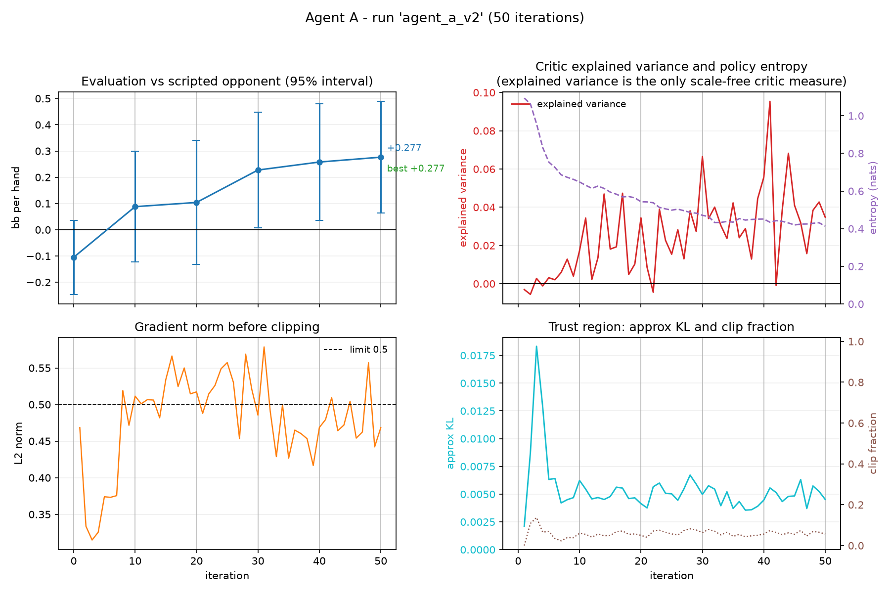
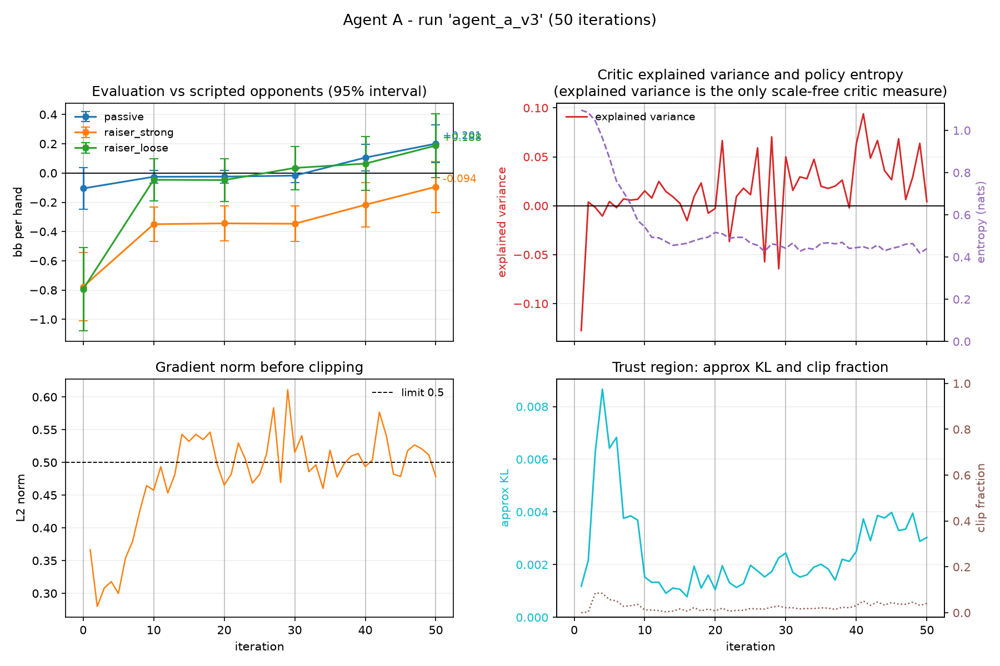

# Poker AI Arena

Heads-up Limit Texas Hold'em as a controlled testbed for reinforcement learning.

Two agents will eventually be trained with PPO and compared:

| | Agent A | Agent B |
|---|---|---|
| Network | feed-forward MLP | MLP + GRU |
| Input | current observable state | current observable state **+ betting history** |
| Question | baseline | does memory of opponent actions help? |

**Research question:** *Does recurrent memory of opponent actions improve
reinforcement-learning performance in heads-up poker?*

**Current stage: complete through Stage 5, with a qualified answer to the
research question.** Against the original memoryless scripted opponents, memory
does not pay: training with the channel was worth `+0.007` to `+0.020` bb/hand
over a capacity-matched control with the sign flipping across seeds, and zeroing
the channel cost under `0.01` bb/hand. Against `first_raiser`, a bot whose
post-flop play depends on a fact the 131-feature observation cannot encode,
training with memory is worth **`+0.276` bb/hand over the control** on the
training opponent (3/3 seeds positive, 2/3 resolved) and is positive on every
held-out opponent (3/3 seeds each). But the trained policy still barely uses the
channel: the within-checkpoint ablation is `-0.007` bb/hand and removing it
changes only 0.4-1.3 % of greedy actions. The evidence points to memory acting
as a **training-time scaffold**: it lets PPO find the mode-conditional strategy,
after which the trunk absorbs a features-only proxy for the mode. Breaking that
proxy at evaluation time does not revive reliance (`+0.0035` bb/hand), so the
channel is not decision-relevant even when the features cannot reveal the
agent's own pre-flop action.

That is exactly the failure mode predicted when the opponent was designed.
Reaching the same chips and raise count in both modes requires the agent to act
differently, so a deterministic card-based preflop policy can recover the mode
without memory. The body of the README reports both experiments, the
identifiability probes, the paired matrices, the reliance curves, and the
limitations.

Stage 1 exists so later results are not built on guesses about RLCard's
observations, actions, payoffs or history handling. The history encoding is data
preparation only: it turns actions into fixed-size arrays and learns nothing.

---

## Repository layout

```
poker-ai-arena/
├── src/
│   └── poker_arena/
│       ├── __init__.py
│       ├── encoding.py             # Agent A's 131-number state vector
│       ├── environment.py          # Stage 1 inspection helpers
│       ├── history.py              # Agent B's betting-history tokens
│       ├── networks.py             # Agent A's policy/value MLP
│       ├── networks_b.py           # Agent A's trunk + a GRU over the history
│       ├── opponents.py            # scripted bots whose play depends on the action order
│       ├── ppo.py                  # clipped PPO update (shared core)
│       ├── ppo_b.py                # the same update with history tensors
│       ├── rollout.py              # rollout buffer + GAE for the PPO update
│       ├── rollout_b.py            # history-aware rollout collection
│       ├── training.py             # training loop + fixed-seed evaluation
│       └── training_b.py           # Agent B loop + policy-based paired evaluation
├── scripts/
│   ├── diagnose_value.py           # how predictable is the value target?
│   ├── test_encoding.py            # executable encoder report
│   ├── test_environment.py         # executable smoke test / report
│   ├── test_history.py             # executable history-encoding report
│   ├── test_networks.py            # executable network report
│   ├── test_ppo.py                 # executable PPO-update report
│   ├── test_rollout.py             # executable rollout / GAE report
│   ├── test_agent_b.py             # Agent B network / rollout / eval report
│   ├── plot_training.py            # reads a run's CSVs, writes a PNG
│   ├── paired_evaluation.py        # compares two checkpoints on identical deals
│   ├── compare_agents.py           # A/B, control-arm and history-ablation comparison
│   ├── compare_matrix.py           # the whole seed x opponent matrix, one table
│   ├── history_reliance.py         # how often removing memory changes the action
│   ├── history_probe.py            # is the opponent's hidden mode in the observation?
│   ├── proxy_break.py              # does memory matter once the card proxy is broken?
│   ├── train_agent_a.py            # trains Agent A and evaluates it
│   └── train_agent_b.py            # trains Agent B (or its control arm)
├── tests/
│   ├── conftest.py                 # puts src/ on sys.path for pytest
│   ├── test_agent_b.py             # history network, rollout, PPO, evaluation
│   ├── test_compare_matrix.py      # batch comparison driver plumbing
│   ├── test_encoding.py            # encoder tests
│   ├── test_environment.py         # Stage 1 contract tests + reset correction
│   ├── test_history.py             # history-encoding tests
│   ├── test_networks.py            # network tests
│   ├── test_opponents.py           # hidden-mode collisions on real RLCard states
│   ├── test_ppo.py                 # PPO-update tests
│   ├── test_proxy_break.py         # sampled/forced opening invariants
│   ├── test_rollout.py             # rollout and GAE tests
│   └── test_training.py            # training-loop and evaluation tests
├── .venv/                          # local environment (git-ignored)
├── docs/
│   ├── agent_a_curve.png           # figure from the second full run
│   └── agent_a_v3_curve.png        # figure from the third full run
├── .gitignore
├── pytest.ini                      # limits collection to tests/
├── requirements.txt
└── README.md
```

The maintained workflow is plain Python modules, scripts and pytest files — there
are no notebooks. An early exploratory notebook was removed from the repository;
it is still recoverable from commit `f8a4a0a` if ever needed. The empty
pre-existing `tets_poker/` folder is left on disk but is not tracked.

---

## Setup

Windows PowerShell. Adjust the path if the project is moved.

```powershell
cd "C:\Users\laksh\OneDrive\Documents\Default Project\poker-ai-arena"

# Create the environment only if .venv does not already exist.
python -m venv .venv

# Activate it.
.\.venv\Scripts\Activate.ps1

# Install the pinned dependencies.
python -m pip install --upgrade pip
python -m pip install -r requirements.txt
```

If PowerShell blocks the activation script:

```powershell
Set-ExecutionPolicy -Scope Process -ExecutionPolicy Bypass
.\.venv\Scripts\Activate.ps1
```

Verified with Python 3.14.6, `rlcard` 1.2.0, `numpy` 2.5.4, `pytest` 9.2.0,
`torch` 2.15.0 and `matplotlib` 3.11.2. Stage 1 imports only `rlcard`, `numpy`
and `pytest`; Agent A's encoder, network and rollout modules add `torch`.
`matplotlib` is installed for later plots.

---

## Running the smoke test and tests

From the project root, with the virtual environment activated:

```powershell
python scripts\test_environment.py
python scripts\test_history.py
python scripts\test_encoding.py
python scripts\test_networks.py
python scripts\test_rollout.py
python scripts\test_ppo.py
python scripts\test_agent_b.py
python -m pytest -q

# Train Agent A, then evaluate as it goes.
python scripts\train_agent_a.py

# Train Agent B, and the no-history control arm.
python scripts\train_agent_b.py
python scripts\train_agent_b.py --no-history --run-name agent_b_control

# Plot that run's CSV logs to runs\<run-name>_curve.png.
python scripts\plot_training.py --run-name agent_a_v3

# Compare two checkpoints on exactly the same deals.
python scripts\paired_evaluation.py `
  --checkpoint-a checkpoints\agent_a_v3_0050.pt `
  --checkpoint-b checkpoints\agent_a_v3_0000.pt `
  --opponent raiser_loose

# Compare A, B, the control arm, or B's history ablation on identical deals.
python scripts\compare_agents.py `
  --a checkpoints\agent_b_seed0_0050.pt `
  --b checkpoints\agent_b_control_seed0_0050.pt `
  --opponent raiser_loose

# Run every mode x seed x opponent comparison and write one table.
python scripts\compare_matrix.py --hands 2000 --out runs\b_matrix.md

# Diagnose how much of the value target is predictable at all.
python scripts\diagnose_value.py
```

Without activation:

```powershell
.\.venv\Scripts\python.exe scripts\test_environment.py
.\.venv\Scripts\python.exe scripts\test_history.py
.\.venv\Scripts\python.exe scripts\test_encoding.py
.\.venv\Scripts\python.exe scripts\test_networks.py
.\.venv\Scripts\python.exe scripts\test_rollout.py
.\.venv\Scripts\python.exe scripts\test_ppo.py
.\.venv\Scripts\python.exe scripts\test_agent_b.py
.\.venv\Scripts\python.exe -m pytest -q

# Agent B, and the no-history control arm.
.\.venv\Scripts\python.exe scripts\train_agent_b.py
.\.venv\Scripts\python.exe scripts\train_agent_b.py --no-history --run-name agent_b_control
```

The training script takes flags if the defaults are too slow for a quick check:

```powershell
# A quick smoke run: about 15 seconds.
python scripts\train_agent_a.py --iterations 3 --hands 64 `
  --eval-hands 200 --eval-every 1 --run-name smoke

# The full run, writing runs\agent_a_*.csv and checkpoints\agent_a_*.pt.
python scripts\train_agent_a.py --iterations 50 --hands 320
```

The environment smoke test ends with `All Stage 1 checks passed.`, the history
smoke test with `All history-encoding checks passed.`, the encoder report with
`All observation-encoder checks passed.`, the network report with
`All network checks passed.`, the rollout report with
`All rollout checks passed.`, the PPO report with `All PPO checks passed.`, the
Agent B report with `All Agent B network checks passed.`, and the test suite
currently reports `204 passed`.

`pytest.ini` limits collection to `tests/` because
`scripts/test_environment.py` and `tests/test_environment.py` share a filename
(and likewise for `test_history`). Both scripts and `tests/conftest.py` add
`src/` to `sys.path`, so no package installation is required.

### What the smoke test covers

1. **Environment contract** — two players, four actions, observation shape.
2. **Initial state** — a fresh `reset()`, before any action: two hole cards,
   no public cards, empty action history.
3. **Gameplay states** — one complete hand with uniformly random legal actions,
   printing every decision state and the final payoffs.
4. **Consecutive hands** — 100 hands on one environment, checking termination,
   zero-sum payoffs and that `reset()` clears the action recorder.
5. **Information hiding** — at every decision, both players' observations are
   checked against perfect information. Only the player's own hole cards and the
   public cards may appear.
6. **API summary** — the verified simulator contract.

`scripts/test_history.py` plays a tracked hand, prints the token table it
produced, and then checks 200 random hands: token order matches
`env.action_recorder`, masks are prefixes with no padding leaking through, all
features stay in `[0, 1]`, and nothing exceeds the 32-token capacity.

`scripts/test_encoding.py` prints Agent A's 131-number vector block by block for
one hand, then checks 100 random hands: every value stays in `[0, 1]`, all four
streets are visited, the legal mask matches the environment at every decision,
and the pot feature reaches its ceiling.

---

## Agent A observation encoder

`encoding.py` turns `state["raw_obs"]` into the single 131-number vector the
policy/value MLP reads. Anything the network can ever know about a state is in
this vector, so it is also the boundary of the comparison with Agent B: Agent B
receives these same features plus the action tokens from `history.py`.

| Index | Width | Feature | Why it is there |
|---|---|---|---|
| 0–51 | 52 | own hole cards, multi-hot | card identity without implying an order |
| 52–103 | 52 | public cards, multi-hot | RLCard merges both into `obs[0:52]`, so holding A on a K-high board would look identical to holding K on an A-high board |
| 104–123 | 20 | 4 streets × 5 raise slots | already in the observation; kept one-hot so no ordering is pre-committed |
| 124–127 | 4 | street one-hot | recoverable from the board size, but stating it explicitly is 4 dims |
| 128 | 1 | pot ÷ 48 bb | absent from the observation |
| 129 | 1 | chips to call ÷ 2 bb | absent from the observation |
| 130 | 1 | posted the small blind | RLCard randomises the blinds every hand |

All values are in `[0, 1]` and `float32`. The two ceilings are measured rather
than guessed: `pot` reaches 48 bb and `to_call` reaches 2 bb under the 4-raise
cap. `ObservationEncoder.from_environment(env)` checks those betting parameters
and refuses to build the encoder if they change, because a silently saturated
feature is worse than a failed start.

```python
encoder = ObservationEncoder.from_environment(env)
net = PolicyValueNet()

state, player_id = env.reset()
small_blind = small_blind_player(state)          # once per hand
small = player_id == small_blind

while not env.is_over():
    encoded = encoder.encode(state, is_small_blind=small)
    logits, value = net(
        torch.from_numpy(encoded.features).unsqueeze(0),   # (1, 131)
        torch.from_numpy(encoded.legal_mask).unsqueeze(0),  # (1, 4)
    )                                                   # (1, 4), (1,)
    action = Categorical(logits=logits).sample()
    ...
```

The legal-action mask comes back alongside the features and is **applied to the
logits, never fed in as an input**. Enforcing it at the output is exact; teaching
the network to respect it from a feature is not. The mask is copied from
`state["legal_actions"]`, so the encoder cannot disagree with RLCard about what
is legal, and `PolicyValueNet.forward` applies it before the logits leave the
module.

`small_blind_player()` must be called on the state from `reset()`, because the
blind postings are the only moment the chip contributions identify the seats. It
raises if handed a mid-hand state, where the chips are already level or
re-raised.

---

## Agent A policy/value network

`networks.py` holds one `nn.Module`: a shared trunk that reads the 131 numbers
and two heads that read the trunk.

| Part | Shape | Parameters |
|---|---|---|
| trunk | `131 → 256 → 256`, ReLU | 99,584 |
| policy head | `256 → 4`, no softmax | 1,028 |
| value head | `256 → 1` | 257 |
| **total** | | **100,869** |

Orthogonal initialisation: gain `√2` on the trunk, **0.01** on the policy head,
1.0 on the value head. The small policy gain keeps the first policy close to
uniform instead of committing to one action on random weights.

```python
net = PolicyValueNet()
logits, value = net(features, legal_mask)   # (B, 4) masked, (B,)

dist = torch.distributions.Categorical(logits=logits)
action = dist.sample()
log_prob = dist.log_prob(action)            # what PPO needs
```

The module returns **logits, not probabilities**, because PPO wants `log_prob`
and `entropy`, and `log_softmax` is more numerically stable than `log(probs)`.
It does not sample, compute a loss or keep bookkeeping — that is the rollout's
job.

### The mask lives inside `forward`

`legal_mask` is a required argument. There is no unmasked path, because the
alternative fails silently in three separate places. RLCard **substitutes** an
illegal action instead of rejecting it (`envs/limitholdem.py:90-96`: play
`check` if possible, otherwise `fold`). Measured on an untrained network, at a
state where the raise cap is reached and the only legal actions are call and
fold:

```text
unmasked probabilities : call 0.250  raise 0.250  fold 0.250  check 0.250
unmasked draws of raise: 2508 / 10000
environment executed   : 'fold'      <- not an error, a substitution
masked draws of raise  : 0 / 10000
```

So a policy that thinks it is raising **folds the hand**. And if the update
remembers the mask while sampling forgot it, the stored log-probability belongs
to an action that never happened: the ratio
`exp(logπ_new(raise) − logπ_old(raise))` becomes `exp(−1e9 + 1.3)`, which
underflows to exactly `0`. The sample then contributes nothing — no NaN, no
warning — so exactly the rarest cap states are quietly dropped from training.

Illegal logits become `-1e9`, not `-inf`. Both give probability exactly `0` and
both leave the chosen action's log-probability untouched, but `-inf` makes the
entropy `0 × -inf = NaN`, and one NaN poisons every gradient in the batch.

Consequences the tests pin down: probabilities of illegal actions are exactly
`0.0`, 10,000 samples from a capped state never return `raise`, the gradient at a
masked logit is exactly `0.0` while the shared trunk still receives gradient, and
the value head is unaffected by the mask. A mask row with no legal action raises
instead of turning every logit into `-1e9` and silently producing a uniform
distribution.

`scripts/test_networks.py` prints the architecture, one real forward pass, the
masked-vs-unmasked comparison above, and per-layer gradient magnitudes for one
PPO-style loss.

---

## Rollout collection and credit assignment

A poker hand pays out once. Every decision inside the hand receives reward `0`
and the hand's payoff arrives after the last action. The obvious rollout gives
every decision the same terminal number and subtracts its baseline:

```text
A_t = R - V(s_t)
```

On a three-decision hand that loses 3 bb, with `V` rising because the board
helped:

```text
 t  decision                       V(s_t)    R - V
 0  preflop call (value rose)        0.00    -3.00
 1  flop check  (value rose)         1.00    -4.00
 2  river fold  (value collapsed)    1.50    -4.50
```

Every decision is punished, including the two that **raised** the value
estimate. Trained on this, the agent learns to stop calling and to stop checking
when it improves — the opposite of the truth.

`rollout.py` assigns credit with temporal-difference residuals instead:

```text
delta_t = r_t + gamma * V(s_{t+1}) - V(s_t)
A_t     = delta_t + (gamma * lambda) * A_{t+1}
```

`delta_t` asks "did the state get better or worse than the value head expected?",
which each decision can answer on its own:

```text
 t  decision                       V(s_t)   delta    lam=0   lam=.95   lam=1
 0  preflop call (value rose)        0.00    1.00     1.00     -2.59   -3.00
 1  flop check  (value rose)         1.00    0.50     0.50     -3.78   -4.00
 2  river fold  (value collapsed)    1.50   -4.50    -4.50     -4.50   -4.50
```

`lambda = 1` reproduces `R - V(s_t)` **exactly** (the test asserts the identity),
and `lambda = 0` blames only the transition that moved the value. `gamma = 1.0`
because chips do not decay and the objective is the undiscounted expected payoff.

The table is also the honest caveat: over a four-decision hand the terminal
shock still reaches the first decision with weight `0.95³ ≈ 0.86`, so `0.95`
sits much closer to the naive version than the intuition suggests. `0.95` is a
reasonable starting point, not a solved choice; the PPO step will report the
advantages it actually sees.

There is no version of this that adds information. Rewarding pot growth teaches
the agent to put chips in and never fold, and the only per-decision shaping that
provably preserves the optimal policy is potential-based; with `phi = V` it
reduces to the TD residual above.

### What is stored

One trajectory **per recorded player per hand**, because `V(s)` is from the
acting player's point of view. In self-play both seats are recorded and their
payoffs are `+R` and `-R`.

```python
@dataclass(frozen=True)
class Transition:
    features: np.ndarray    # (131,) float32, from the encoder
    legal_mask: np.ndarray  # (4,) bool, copied at decision time
    action: int
    log_prob: float         # read from the same forward pass that sampled
    value: float            # same forward pass

@dataclass(frozen=True)
class Trajectory:
    transitions: tuple[Transition, ...]
    final_payoff: float     # big blinds, this player's perspective
```

`log_prob` and `value` are captured at sampling time on purpose. Recomputing
them with updated weights makes the PPO ratio meaningless.

```python
trajectories = collect_trajectories(env, encoder, net, hands=25, rng=seeded)
buffer = RolloutBuffer()
for trajectory in trajectories:
    buffer.add_trajectory(trajectory)
batch = buffer.batch()          # (N, 131), (N, 4), (N,)
normalised = normalize_advantages(batch.advantages)   # inside the PPO step
```

`opponent=None` means self-play and records both seats; passing a callable
`(state, player_id) -> action_id` makes it play player 1, so only player 0 (the
learner) is recorded. A hand where the small blind folds preflop leaves the big
blind with zero decisions; those are dropped rather than stacked, because GAE
over zero steps is `0/0` and one empty row would poison the batch.

`RolloutBuffer.batch()` returns **raw** advantages. Normalising here would
silently break `returns == advantages + values`; the PPO step normalises a copy
after computing both.

### What the tests pin down

`tests/test_rollout.py` (30 tests) asserts the `lambda = 1` identity, the
`lambda = 0` residual, both columns of the worked example, `returns ==
advantages + values` for every `lambda`, that the terminal transition
bootstraps from `0` (a losing last decision cannot inherit a phantom
continuation value), that an over-optimistic value estimate is corrected by the
payoff, normalisation to mean `0` / std `1`, zeros instead of a division by zero
on a flat batch, buffer stacking order and dtypes, rejection of bad widths,
non-finite scalars, illegal stored actions and empty trajectories, that stored
log-probabilities reproduce a fresh forward pass, that collected actions are
legal, that self-play payoffs are zero-sum and equal `env.get_payoffs()`, that a
callable opponent only ever plays player 1, and that the same seeds reproduce
identical rollouts.

`scripts/test_rollout.py` prints the tables above, one real hand decision by
decision, and a 25-hand batch summary. A representative batch: 47 trajectories,
82 decisions, zero illegal stored actions, raw advantage std `4.30` bb — one
argument for normalising before the update.

---

## PPO update

`ppo.py` optimises one rollout batch at a time:

```text
L_policy = -mean( min(ratio * A, clamp(ratio, 1-eps, 1+eps) * A) )
L_value  =  mean( (V(s) - return)^2 )
L        =  L_policy - entropy_coef * H[pi] + value_coef * L_value
ratio    =  exp(log_pi_new(a) - log_pi_old(a))
```

| Setting | Value |
|---|---|
| clip epsilon | 0.2 |
| entropy coefficient | 0.01 |
| value coefficient | 0.5 |
| epochs | 4 |
| minibatch size | 256 |
| max gradient norm | 0.5 |
| optimiser | Adam, `3e-4` |

### The old log-probability must be a constant

On the first pass the network that samples and the network being scored are the
same, so `ratio` is exactly `1` and the clip cannot bind. The clip exists for the
later epochs: once the weights have moved, it stops one batch from being
over-exploited.

That only works because `log_pi_old` is a stored constant. Recompute it from the
current weights and `ratio` becomes `exp(0) = 1` on every pass; the clip never
binds, no error is raised, and PPO quietly degrades into a policy gradient that
can walk arbitrarily far from the sampling policy. The report makes this
visible by shifting the stored log-probabilities by `5`:

```text
fresh log-probs : clip fraction 0.0000, approx KL 5.81e-03
stale log-probs : clip fraction 1.0000, approx KL 4.0087
```

### Two details that are easy to get wrong

* **Advantages are normalised once per rollout**, before the epochs start, not
  per minibatch. Per-minibatch normalisation changes what the same sample means
  on every pass. A test asserts that multiplying every advantage by 1,000 leaves
  the update unchanged.
* **Returns are divided by their own rollout standard deviation**, so the value
  loss is `MSE / Var(return)`: a fraction of variance rather than a squared
  number of big blinds. With raw returns the loss is not comparable between
  iterations and the critic's gradient dominates the shared clip. `returns ==
  advantages + values` from the buffer, before the division.

The value loss is deliberately **not** clipped. Clipping the value is a second
mechanism with its own failure modes; it is worth adding only if the value loss
is observed to explode. Global gradient-norm clipping is there from the start —
in the report the pre-clip norm is `1.01` against a limit of `0.5`, so the clip
is doing real work.

### What the report measured

A 320-hand self-play rollout (about 1,000 decisions, value loss `10.38`, entropy
`1.096`, zero illegal stored actions), then four epochs:

```text
value loss  10.3786 -> 10.0110      entropy 1.0962 -> 1.0903
clip fraction 0.0000                approx KL 0.0017
grad norm (pre-clip) 1.0059         illegal probability 0.0
```

The value loss falls; the policy barely moves in one update, which is expected
at `3e-4` with an advantage signal this noisy.

That report predates the value-target normalisation, so its `10.38` is a raw
MSE. After the change the same batch reports `~1.0`, which is the fraction of
return variance left unexplained; see the diagnosis section below.

### A measured footgun: Adam's step size versus the entropy bonus

An early version of the entropy test used `learning_rate=1e-2`. With a strong
entropy coefficient the entropy **fell** (`1.3805 -> 0.6708`) instead of rising.
The gradient pointed the right way; Adam normalises each parameter's step to
roughly the learning rate regardless of gradient magnitude, so the policy
overshot the near-uniform maximum. The test now uses `1e-3`. The lesson is not
"entropy is broken" but "with Adam, a large learning rate can turn any bonus
into an overshoot", so the reported learning rate is part of the objective's
behaviour, not just a training detail.

### Diagnostics

`PPOUpdater.step()` returns `policy_loss`, `value_loss`, `explained_variance`,
`return_std`, `entropy`, `total_loss`, `approx_kl`, `clip_fraction`, `grad_norm`
(all means over the minibatches), plus `epochs`, `minibatches` and `samples`. A
single loss number hides which term is misbehaving; `approx_kl` and
`clip_fraction` are the two that say whether the update is still inside its
trust region, and `explained_variance` is the only scale-free reading of the
critic.

### What the tests pin down

`tests/test_ppo.py` (23 tests) pins the defaults and rejects invalid settings,
checks that an update changes parameters and returns finite diagnostics, that
fresh log-probabilities start with `ratio == 1` (clip fraction `0`, KL `0`) and
stale ones clip every sample, that zero advantages leave the policy head
bit-identical while the value head still learns, that the value loss moves the
value towards its targets, that the entropy bonus raises entropy from a sharp
policy, that advantage scaling is invariant, that unnormalised huge advantages
engage gradient clipping, minibatch accounting, seeded reproducibility, that the
network is left in training mode, batch validation, illegal actions staying at
exactly zero probability after updates, and a full rollout → update → rollout
cycle.

---

## Training loop and evaluation

`training.py` connects the pieces without adding a new dependency:

```text
evaluate 2,000 fixed-seed hands vs each evaluation opponent   (iteration 0)
for iteration in 1..N:
    collect 160 self-play hands                 -> both seats recorded
    collect 160 hands vs the training opponent  -> learner's seat recorded
    RolloutBuffer.batch()                       -> raw advantages, returns
    PPOUpdater.step()                           -> one update, 4 epochs
    write the diagnostics row to CSV
    every 10 iterations, and on the last one:
        for each evaluation opponent:
            evaluate 2,000 fixed-seed hands
            write the evaluation row
        write one checkpoint
```

The decision count is not constant: it depends on how long the current policy
keeps a hand alive, which changes as it learns.

### Why the rollout is a mixture

Training against one scripted opponent invites pattern-matching instead of poker.
Training only against itself can never discover a raise the policy would not
invent on its own. The rollout therefore spends half its hands in self-play
(both seats recorded, so the network sees the game from both sides) and half
against a scripted opponent. Both halves feed **one** PPO update, so the two
kinds of experience share a value scale instead of alternating between two
objectives.

`--self-play-fraction` sets the split; `--training-opponent` picks the scripted
bot. The defaults are `0.5` and `raiser_strong`, which raises only hole cards its
simple score likes.

### Why there are three evaluation columns

Evaluation only answers a useful question if the opponent is not the one being
trained against:

| Opponent | Style | Job in the report |
|---|---|---|
| `passive` | always calls or checks | continuity ruler: every earlier run was measured against it |
| `raiser_strong` | raises only strong hole cards | exploitation reference, and the default training opponent |
| `raiser_loose` | raises a fixed 35 % of the time, regardless of cards | **held-out generalisation ruler**; never used for training |

A rising `raiser_strong` column can mean "solved the bot". A rising
`raiser_loose` column cannot: it differs in style, not just aggression, and the
network has never seen it. That is the column that tests transfer.

### Why evaluation is separate from the training reward

The training batch is the data the policy is being fitted to, so its average
payoff is an optimistic, high-variance number. Evaluation replays the *same*
deals, from the same `evaluation_seed`, against the *same* scripted opponent
every time. A change in that column is a change in the policy, not in the deal
or the opponent.

Evaluation plays **greedily** (`argmax` over the masked logits). The sampling
policy is what is trained, but the mode is what a fixed-seed comparison should
measure: sampling would add action noise on top of deal noise and make two runs
with the same seed diverge for no reason.

### How many hands does a measurement need?

The per-hand standard deviation is **not a property of the game** — it depends on
how many chips the current policy puts in. In the first run it was `1.6` bb at
iteration 10 and `5.1` bb at iteration 50. The 95 % interval is
`1.96 × σ / sqrt(n)`:

| Hands | Interval at σ = 1.6 | Interval at σ = 5.1 |
|---|---|---|
| 500 | `±0.140` | `±0.446` |
| 2,000 | `±0.070` | `±0.223` |
| 10,000 | `±0.031` | `±0.100` |
| 40,000 | `±0.016` | `±0.050` |

So against the trained policy, resolving a `0.05` bb edge needs about **40,000**
hands, not the ~9,000 an earlier estimate of σ ≈ 2.4 bb suggested. That estimate
came from the untrained policy, which played short, small pots. The harness
computes `stderr` from the sample it actually observed, so the printed interval
stays correct; only the planning number was wrong.

This is also why the interval is printed next to every evaluation and why a
small movement between checkpoints should not be read as progress. It rules out
the training reward as a progress signal too: it is one noisy sample per
iteration, from a moving opponent and a changing policy.

### Paired evaluation: the same deals for both checkpoints

`evaluate()` compares two means measured on *different* deal streams, so the
standard error of the change is `sqrt(se_a² + se_b²)`. Most of a hand's payoff
variance is the deal — the cards, the blinds, the board — not the policy. If both
checkpoints play the *same* deal, that common variance cancels.

`evaluate_paired(net_a, net_b, hands, ...)` replays hand `h` twice, both times
after `env.seed(seed + h)`. It returns the per-hand differences (A minus B), the
mean difference, a 95 % interval computed **from the differences**, and
`unpaired_stderr_bb` for comparison. A stochastic opponent is rebuilt per play
from the same per-hand seed, so its draws are paired as well as the deal. Use it
from the command line with:

```powershell
python scripts\paired_evaluation.py `
  --checkpoint-a checkpoints\agent_a_v3_0050.pt `
  --checkpoint-b checkpoints\agent_a_v3_0000.pt `
  --opponent raiser_loose
```

Checkpoint 0 against checkpoint 50 of run 3, 2,000 paired hands per opponent
(these use the corrected opening observation described below, so the absolute
means differ slightly from the `evaluate()` table):

| Opponent | mean A | mean B | **A − B** | paired 95 % | unpaired 95 % | pairing gain |
|---|---:|---:|---:|---:|---:|---:|
| `passive` | +0.2440 | −0.0455 | **+0.2895** | ±0.1203 | ±0.1919 | 1.6× |
| `raiser_strong` | +0.0185 | −0.6665 | **+0.6850** | ±0.1894 | ±0.2840 | 1.5× |
| `raiser_loose` | +0.2430 | −0.7130 | **+0.9560** | ±0.2225 | ±0.3747 | 1.7× |

All three intervals exclude zero. The improvement is therefore resolved on
identical deals for every opponent, including the held-out style.

### A simulator quirk the paired evaluator exposed

RLCard 1.2.0 builds the opening state of a hand *before* it rebinds
`game.history_raise_nums` (`games/limitholdem/game.py`, around lines 98–101).
The returned `raw_obs["raise_nums"]` is therefore the **previous hand's** list,
and the native `obs[52:72]` raise block is filled from those stale counts. The
first decision of every hand was being encoded with fictitious raises from the
hand before it.

`environment.reset_hand(env)` now resets the environment, replaces the stale list
with zeros on every street, and rewrites the native raise block to its intended
fresh value. The deal is already fixed by `reset()`, so this changes only the
observation. Training, `evaluate()`, `evaluate_paired()` and
`play_random_hand()` all go through it. Measured on checkpoint 50, 500 hands per
opponent, the correction moves the absolute mean by `≤ 0.01` bb/hand and changes
the first-decision action in 1–4 % of hands — far below the evaluation interval,
but it removes a real previous-hand leak.

### Outputs

| File | Contents |
|---|---|
| `runs/<run-name>_train.csv` | one row per iteration: decisions, losses, entropy, KL, clip fraction, gradient norm, minibatches, samples |
| `runs/<run-name>_eval.csv` | one row per evaluation **per opponent**: hands, opponent, mean bb, standard error, 95 % interval, total bb |
| `checkpoints/<run-name>_<iter>.pt` | `state_dict` + iteration + the full training config |

`save_checkpoint` / `load_checkpoint` round-trip the weights exactly; the config
is stored so an evaluation can be reproduced from the file alone. The test suite
asserts that a checkpoint's weights reproduce the evaluation it came from.

### Reproducibility

The network initialisation, the environment, the action sampler and the
minibatch shuffle are all seeded from `config.seed`. Two runs with the same
config produce identical CSVs and identical final weights; the test suite
compares every parameter tensor. The evaluation environment uses a separate
`evaluation_seed`, so changing the training seed does not change the deals the
evaluations are played on.

### What the tests pin down

`tests/test_training.py` (40 tests) pins the defaults, rejects invalid settings,
checks the passive, random, strong-raiser and loose-raiser opponents (including
the hole-card score and the seeded 35 % raise rate), that evaluation returns
finite statistics with `ci95 == 1.96 × stderr` and a zero-sum-consistent total,
that it is deterministic for the same weights and seed and restores the
network's training mode, the checkpoint round-trip and its metadata, the row,
evaluation and checkpoint counts, CSV contents per opponent, evaluation on the
final iteration when it is off schedule, that training changes the weights, the
progress callback order, the edges of the self-play/opponent mixture, and
full-run reproducibility. For paired evaluation it pins exact zero on identical
networks, seeded reproducibility, the algebraic identities on the difference,
the tighter-than-unpaired interval, restoration of both training modes, and the
per-hand replay of a stochastic opponent's draws.

---

## Three 50-iteration training runs

```powershell
python scripts\train_agent_a.py --run-name agent_a      # run 1, original harness
python scripts\train_agent_a.py --run-name agent_a_v2   # run 2, value-loss scale fixed
python scripts\train_agent_a.py --run-name agent_a_v3   # run 3, mixed training + three opponents
python scripts\plot_training.py --run-name agent_a_v3 --output docs\agent_a_v3_curve.png
```

Runs 1 and 2 use seed 0, 320 self-play hands per iteration, and a 2,000-hand
evaluation against the passive opponent every 10 iterations. Run 3 uses seed 0,
**160 self-play hands plus 160 against `raiser_strong`** per iteration, and
evaluates 2,000 hands against each of three opponents. Its passive column is
therefore directly comparable to runs 1 and 2; the two raiser columns are new.

### Run 1: the original harness

The full run took a few minutes on CPU and produced 159,035 decisions.

| Iteration | Decisions | Value loss | Entropy | Eval (bb/hand) | 95 % |
|---|---|---|---|---|---|
| 1 | 945 | 7.95 | 1.094 | — | — |
| 10 | 3,399 | 78.33 | 0.733 | −0.040 | ±0.069 |
| 15 | 4,150 | **128.07** (peak) | 0.617 | — | — |
| 20 | 3,567 | 78.50 | 0.671 | **+0.292** | ±0.172 |
| 30 | 3,354 | 56.77 | 0.633 | +0.223 | ±0.225 |
| 40 | 3,200 | 55.18 | 0.583 | +0.161 | ±0.241 |
| 50 | 3,229 | 60.57 | 0.596 | +0.230 | ±0.223 |

Run 1 has no iteration-0 evaluation — a gap the harness now fills. Reconstructing
the initial network (same seed, `torch.manual_seed(0)` then `PolicyValueNet()`)
and replaying the same 2,000 deals gives:

```text
initial net   : -0.1050 bb/hand  (+/- 0.1411)
final net     : +0.2295 bb/hand  (+/- 0.2228)
paired change : +0.3345 bb/hand  (+/- 0.1539 paired 95%)
```

### Run 2: iteration 0 measured, critic scale fixed

`value loss` here is `MSE / Var(return)`, the fraction of return variance left
unexplained, and `EV` is the critic's explained variance (`1 - value loss`).
Both are scale-free, unlike run 1's raw big-blind MSE.

| Iteration | Decisions | Value loss | EV | Entropy | Eval (bb/hand) | 95 % |
|---|---|---|---|---|---|---|
| 0 | — | — | — | — | **−0.1050** | ±0.1411 |
| 1 | 945 | 0.985 | −0.00 | 1.094 | — | — |
| 10 | 3,851 | 0.963 | 0.02 | 0.648 | +0.0880 | ±0.2108 |
| 20 | 3,739 | 0.945 | 0.03 | 0.543 | +0.1040 | ±0.2363 |
| 30 | 3,369 | 0.908 | 0.07 | 0.471 | +0.2275 | ±0.2203 |
| 40 | 3,423 | 0.924 | 0.06 | 0.451 | +0.2580 | ±0.2223 |
| 50 | 3,345 | 0.937 | 0.03 | 0.414 | **+0.2765** | ±0.2128 |



The plot is written by `scripts/plot_training.py`; the copy above is run 2.

The iteration-0 row is a logged measurement, not a reconstruction, and it returns
`-0.1050 ± 0.1411` — the same number run 1's start had to be rebuilt to obtain.
That is the check that changing the critic's loss did not change the game.

```text
iteration  0 : -0.1050 bb/hand  (+/- 0.1411)
iteration 50 : +0.2765 bb/hand  (+/- 0.2128)
paired change: +0.3815 bb/hand  (+/- 0.1500 paired 95%, 2,000 deals)
```

The unpaired intervals overlap, but pairing the same deal removes most of the
variance: the paired interval excludes zero, so the improvement is resolved even
though neither individual measurement is precise to 0.21 bb. That is the whole
argument for fixed-seed evaluation, and for pairing rather than comparing two
independent means.

The critic's per-iteration `EV` stays in `-0.00 … 0.10` (mean ≈ `0.03`), which is
exactly the information ceiling measured below. The critic did not get better,
and was not supposed to: the fix was to measure it on a stable axis and stop its
raw loss from setting the gradient clip. Gradients now sit at `0.31–0.58`
against a limit of `0.5`, so the clip is an occasional brake rather than the
permanent operating point.

Decisions per hand rose from **3.0 to 10.1** in run 1: the agent stopped folding
and started playing hands to the end. Against an opponent that never folds, that
is the correct direction. Run 2 reproduces the same behaviour.

### Run 3: mixed training and a held-out opponent

Run 3 changed the opponent, not the network or the PPO settings. Half of every
rollout is self-play; half is the learner playing player 0 against
`raiser_strong`. Evaluation adds the two raiser columns, and `raiser_loose` is
never trained on.

| Iteration | passive | raiser_strong (train) | raiser_loose (held out) |
|---|---|---|---|
| 0 | −0.1050 ±0.1411 | −0.7768 ±0.2321 | −0.7935 ±0.2831 |
| 10 | −0.0255 ±0.0429 | −0.3495 ±0.1174 | −0.0460 ±0.1452 |
| 20 | −0.0245 ±0.0431 | −0.3440 ±0.1183 | −0.0480 ±0.1457 |
| 30 | −0.0175 ±0.0462 | −0.3465 ±0.1204 | +0.0350 ±0.1480 |
| 40 | +0.1055 ±0.0895 | −0.2170 ±0.1505 | +0.0645 ±0.1836 |
| 50 | **+0.2005** ±0.1283 | **−0.0940** ±0.1743 | **+0.1875** ±0.2174 |



Every number is bb/hand against that opponent, with its own 95 % interval.

The change over the run, with a conservative *unpaired* interval formed from the
two end points:

```text
passive        -0.1050 -> +0.2005   +0.3055   (+/- 0.19 unpaired)
raiser_strong  -0.7768 -> -0.0940   +0.6828   (+/- 0.29 unpaired)
raiser_loose   -0.7935 -> +0.1875   +0.9810   (+/- 0.36 unpaired)
```

Pairing the same deals tightens all three and is now committed; see the paired
evaluation table above. Run 3 itself predates the opening-observation correction
described there, so the new seed-0 rerun (`agent_a_seed0`) is the clean baseline.

**The held-out column rose at least as much as the training opponent.** That is
the result the new design was built to test: the learner did not merely learn the
bot it was trained on. Against a style it had never seen — raising 35 % of the
time regardless of cards — it moved from `-0.79` to `+0.19` bb/hand.

Two cautions about reading the absolute values:

* **`raiser_strong` being the only negative column at iteration 50 is not
  evidence of overfitting.** A bot that raises only strong hands is intrinsically
  the hardest of the three to face: its raises carry information, so calling them
  is expensive. Comparing absolute bb/hand *across* opponents compares opponent
  strength, not the learner's skill. The comparison that means something is each
  column's change from iteration 0.
* **The learner saw only 8,000 hands against `raiser_strong`** (160 per iteration
  × 50), and this is still one seed. The transfer signal is real but noisier than
  a multi-seed result would be.

The critic stayed at its information ceiling: `EV` moved from `-0.13` to `+0.00`
(peak `+0.09`), exactly the `3–5 %` band measured below. Entropy fell from `1.096`
to `0.439`, and the trust region held (`approx KL` max `0.0087`, clip fraction
max `0.086`) even though the gradient norm exceeded `0.5` on 22 of 50
iterations. There were 99,626 decisions in total, about 2,000 per iteration.

### What did not

**The curve still has not been resolved after iteration 20.** The point estimate
keeps rising in run 2 (`+0.104` at 20 to `+0.277` at 50), but the difference
between those two evaluations is about `1.1` standard errors, so it is not
resolved by 2,000 hands. Only the change from iteration 0 is.

**The value head explains only a few percent of the return variance — and that
turns out to be the ceiling, not a defect.** Replaying 320 fresh hands at each
saved checkpoint of run 1 and comparing `V(s)` with the GAE return `G`:

```text
ckpt   return std   MSE     explained variance   correlation
  10       9.73     92.04        0.028             0.189
  20       9.10     83.17       -0.004             0.113
  30       8.69     73.38        0.029             0.191
  40       8.35     68.92        0.010             0.174
  50       7.93     57.58        0.085             0.300
```

Explained variance is the scale-free version of the value loss
(`1 - MSE / Var(G)`); `0` means the head is no better than predicting the mean.
It never exceeds **8.5 %**. The first reading of this was "the critic is broken,
so the baseline behind every advantage is almost constant and PPO is running
close to a plain policy gradient". That reading was wrong, and
`scripts\diagnose_value.py` is what disproved it.

**The value-loss curve is misleading.** It rose from `7.95` to a peak of
`128.07`, then fell to `60.57`. But the return standard deviation rose to `9.7`
during the same phase and then fell to `7.9`, so much of the curve is the target
moving, not the critic getting better or worse. A raw MSE on returns cannot be
compared across iterations.

**Entropy halved** (`1.094 → 0.596`) while evaluation stopped improving, which
is early convergence rather than useful exploration.

### The critic was already at the ceiling

The offline test fits `V` to returns with no policy loss and no moving target,
on one fixed collection of 20,000 hands from checkpoint 50: **162,044 training
decisions, 40,422 held out, split by hand** so that no row from a test hand is
ever trained on. `scripts\diagnose_value.py --hands 20000` reproduces it; the
default 4,000 hands reads `+0.025` instead of `+0.030`, which is the same story
with a wider interval.

Ridge regression on the 131 features, fitted on growing slices of that same
training set:

```text
  train hands  decisions   penalty 10  100   1000
          250      1,290       -0.219  -0.007  0.004
          500      2,586       -0.105  -0.003  0.007
        1,000      5,050       -0.010   0.012  0.012
        2,000     10,139        0.007   0.016  0.017
        4,000     20,242        0.024   0.026  0.023
        8,000     40,720        0.028   0.028  0.026
       31,905    162,044        0.030   0.030  0.030
```

Eight times more data moves the ceiling from `0.024` to `0.030` and then stops.
That is the signature of an **information ceiling**, not of a model that needs
more samples.

Which block carries the signal, at full size:

```text
  own hole cards (0:52)          0.026
  public board (52:104)         -0.000
  raise counts (104:124)         0.004   (inside the scalars)
  pot, to call, blind (128:131)  0.004
  everything                     0.030
```

Per street, the ceiling barely moves: `0.033` preflop, `0.033` flop, `0.029`
turn, `0.027` river, against outcome spreads of `6.9 → 8.9` bb.

And a bigger model does not find interactions that ridge missed, it only
memorises. On the same 162k/40k split:

```text
  MLP 256x2, weight decay 1e-2, best held-out  0.050 at step 1,000
                                       final   -0.218 at step 20,000
  MLP 64x1,  weight decay 1e-3, best held-out  0.050 at step 3,000
                                       final   -0.025 at step 20,000
```

Train explained variance on those runs reaches `0.65`. A earlier probe on 2,000
hands showed the same thing more starkly: train `0.96`, held-out `-0.62`.

**So the ceiling is about 3–5 %, and it belongs to the target, not to the
network.** The reason is in the data: the payoff's *magnitude* is highly
predictable — `corr(|payoff|, pot)` is `0.26` preflop and `0.78` on the river —
but its *sign* depends on the opponent's hole cards, which are not observable.
The conditional mean therefore varies far less than the outcome:

```text
  Var(V(s))  <=  Var(E[G | s])  ~=  0.03 x Var(G)
  prediction spread of a perfect critic  ~=  1.4 bb
  spread of the outcomes themselves      ~=  7.9 bb
```

That bound is the whole story. Even a perfect critic is only allowed to move
its baseline by about a big blind and a half, so roughly `97 %` of the variance
in `G - V(s)` survives no matter what the critic does. **Advantage noise in
this game is fundamental, and it has to be bought with samples per update — not
with a better value function.**

It also explains the `0.085` at checkpoint 50, which looks *better* than the
`0.030` ceiling. It is not: 320 hands is about 1,600 decisions, and an explained
variance estimated on 1,600 rows has a standard error near `sqrt(2 / 1600)`, or
`0.035`. The two numbers are the same number.

### What this changed in the code

Two of the three things the diagnosis pointed at were measurement bugs, and both
are fixed:

* **`value_loss` is now `MSE / Var(G)`**, so it reads as the fraction of return
  variance left unexplained and `explained_variance = 1 - value_loss`. The
  critic is compared on one axis across iterations instead of on a number that
  moves with the policy.
* **`explained_variance` is logged every iteration**, computed from the rollout's
  stored values before the update, and plotted instead of the raw loss.
* **Iteration 0 is evaluated.** The first run's starting point had to be
  reconstructed from the seed and replayed; the harness now measures it.

One side effect was worth measuring. On a fresh 3,336-decision rollout the raw
value term was `99.8 %` of the pre-clip gradient norm (`5.07` against `0.087`
for the policy term), so the global clip at `0.5` was permanently saturated and
rescaling every minibatch by a factor set by the critic's error. Adam is almost
invariant to a *constant* rescale, and measured directly, clipping at `0.5`
versus not clipping changed the summed parameter update by only about `4 %` —
so this was **not** costing the actor a factor of ten. It is still worth
removing, because a clip whose factor jumps between minibatches perturbs Adam's
momentum for reasons that have nothing to do with the policy. With the loss
normalised the batch reports `0.48`, so the clip is an emergency brake again.

**The network was not changed.** `CardNet`, a shared card embedding with sum
pooling over the hole and board blocks — the DeepSets shape that matches how
these features are built — reached `0.029` held out at its best setting, against
`0.031` for plain ridge on the raw features. Architecture is not where the
missing variance is. Changing `networks.py` would have been work with no
mechanism behind it.

**The trust region was never the problem.** Approx KL stayed below `0.0076`
(mean `0.0036`) and the clip fraction below `0.086`. What looked like
instability in the critic was the ceiling, and what looked like a saturated
gradient norm was the critic's loss scale.


### The caveat that limits the result

Runs 1 and 2 measured only a passive caller, so beating it meant "loses less to
a caller", not "plays well". Run 3 fixes the opponent-design half of that: two
raising opponents, one of them held out by style. What remains is scale — one
seed, 8,000 hands against the training opponent, and no committed paired-difference
script for the new columns. Those are sample-size limits, not opponent-design
limits.

---

## Stage 2 hardening: three seeds and a 4× data run

Run 3 asked whether a held-out style improves alongside the training opponent.
One run cannot answer whether that survives the run-to-run spread, so the
hardening pass repeats the identical configuration under seeds 0, 1 and 2, and
adds one run with four times the data (1,280 hands per iteration, seed 0).
Iteration 50, bb/hand, 2,000 hands per column:

| Run | passive | raiser_strong (trained) | raiser_loose (held out) |
|---|---|---|---|
| seed 0 | +0.1920 ±0.1836 | −0.0385 ±0.2137 | +0.2025 ±0.2863 |
| seed 1 | +0.2095 ±0.1616 | −0.0110 ±0.1972 | +0.1475 ±0.2557 |
| seed 2 | +0.2490 ±0.1718 | +0.0165 ±0.2034 | +0.2875 ±0.2780 |
| 320 mean ± sd | +0.217 ±0.029 | −0.011 ±0.028 | +0.213 ±0.070 |
| 4× data (seed 0) | +0.3400 ±0.1826 | **+0.2405** ±0.2147 | +0.2930 ±0.2701 |

**Every seed ends positive on both held-out columns.** The seed-to-seed spread on
`raiser_loose` (`sd ≈ 0.07`) is smaller than the mean gain (`≈ +0.21`), so the
transfer is not one lucky run.

The 4× run is the only one with a clearly resolved training-opponent column
(`+0.2405` against a `±0.2147` interval), and its held-out column sits about one
seed standard deviation above the three-seed mean. Four times the data therefore
helps, but the extra held-out gain is still inside the run-to-run spread. The
honest reading is "more hands help, and this sample cannot resolve how much";
more hands would keep paying, but further architecture or hyper-parameter tuning
would not, because the critic is already at its information ceiling and the
remaining variance is the deal.

**Decision: freeze Agent A at this configuration.** It starts near a coin flip
and ends at roughly `+0.21` bb/hand against a style it never trained against,
with all three seeds positive. The next question is architectural: does memory of
the opponent's actions add anything that the current observation cannot express?
That is Agent B.

---

## Verified simulator contract (RLCard 1.2.0)

These facts were checked by running code, not copied from documentation.

| Item | Verified behaviour |
|---|---|
| Environment | `rlcard.make("limit-holdem", config={"seed": ...})` |
| Players | 2 |
| Actions | 4: `call`, `raise`, `fold`, `check` |
| Observation | `np.ndarray`, shape `(72,)`, `float64`, one-hot |
| `obs[0:52]` | acting player's hole cards + public cards |
| `obs[52:72]` | 4 betting rounds × 5 raise-count slots |
| `reset()` | returns `(state dict, acting player id)` and clears `action_recorder` |
| `step(id)` | returns `(next state dict, next player id)` |
| `run(is_training)` | returns `(trajectories, payoffs)` |
| Payoffs | `np.ndarray`, chips ÷ big blind, zero-sum, multiples of `0.5` |
| `legal_actions` | `OrderedDict` mapping legal action ID → `None` |
| `raw_legal_actions` | action names in the same order as `legal_actions` |
| `raw_obs` | `hand`, `public_cards` (strings such as `"D2"`), `all_chips`, `my_chips`, `legal_actions`, `raise_nums` |
| `action_recorder` | list of `(player_id, action_name)`; `reset()` clears it |
| Blinds | the small blind is drawn at random each hand (`np_random.randint`) |
| Street order | each street opens with the player after whoever closed the previous one |
| Observations during play | the acting player's own cards + public cards only; opponent hole cards never appear |

### Action IDs

Read these from `env.actions`; do not hard-code them in agent code.

| ID | Name |
|---|---|
| 0 | `call` |
| 1 | `raise` |
| 2 | `fold` |
| 3 | `check` |

### Observation layout

* `obs[0:52]` is a one-hot over the 52-card deck. The order is given by
  `env.card2index`; decode it by inverting that mapping.
* `obs[52:72]` is four consecutive blocks of five slots. Slot `n` is set when
  that betting round has seen `n` raises.
* All four blocks are one-hot from the start of the hand. Future rounds simply
  read as `0` raises, so the preflop view is `(0, 0, 0, 0)`.

### Information-hiding check

For every decision in a complete hand, the smoke test verifies:

```
observed cards == player's own hole cards ∪ public cards
observed cards ∩ opponent's private cards == ∅
```

The two players' observations differ only inside the card region (`index < 52`);
public information is identical for both. `env.get_perfect_information()` is used
for this check only — it exposes both hands and must never be an agent input.

---

## Agent B history encoding

`src/poker_arena/history.py` turns a hand's actions into the input Agent B's GRU
will read. One action becomes one 16-number token:

| Index | Width | Feature |
|---|---|---|
| 0–1 | 2 | actor one-hot: `P0`, `P1` |
| 2 | 1 | `is_self` — the actor is the player deciding now |
| 3–6 | 4 | action one-hot: `call`, `raise`, `fold`, `check` |
| 7–10 | 4 | street one-hot: preflop, flop, turn, river |
| 11 | 1 | raises on this street ÷ 4 |
| 12 | 1 | pot in big blinds ÷ 48 |
| 13 | 1 | chips to call in big blinds ÷ 2 |
| 14 | 1 | actor posted the small blind |
| 15 | 1 | actor is not first to act on this street (in position) |

A hand becomes `tokens: float32[32, 16]`, `mask: bool[32]`, `length: int`:

* Rows after `length` are zero padding, and `mask` is `False` there, so the GRU
  can never mistake filler for a real action.
* An empty history — the first decision of a hand — is an all-`False` mask. The
  GRU starts from its zero hidden state; there is no special start token.
* If a hand ever exceeds 32 actions, the oldest tokens are dropped. Measured
  maxima: 20 actions under an always-raise policy, mean 3.2 under random play.
* Tokens are encoded **per viewer**, so the same action stream gives P0 and P1
  different `is_self` flags. Only index 2 differs between the two views.

```python
tracker = HistoryTracker()
state, player_id = env.reset()
tracker.start_hand(state)

while not env.is_over():
    sequence = tracker.tokens(viewer=player_id)  # (32, 16) + mask + length
    action_id = policy(sequence, state)
    tracker.record(state, player_id, env.actions[action_id])  # before step()
    state, player_id = env.step(action_id)
```

`record()` must be called **before** `step()`: pot, call amount and street are
snapshots of the state the decision was made in, and RLCard's own
`action_record` does not keep them.

The `is_small_blind` and `is_in_position` flags are not redundant. RLCard draws
the small blind at random every hand, and a street opens with whoever follows the
player who closed the previous street, so neither fact follows from the actor id
or the street number. Dropping them would hide information the network cannot
otherwise recover at the first decision of a hand.

---

## Agent B: a GRU over the betting history

Agent A sees 131 numbers that describe *what is true now*. Nothing in them says
who bet, in what order, or whether the opponent has check-raised twice this
street. `history.py` turns every action into a token; Agent B reads that token
stream with a GRU.

### Architecture

```
features (B, 131)                    tokens (B, 32, 16), mask (B, 32)
      |                                       |
131 -> 256 -> 256 (ReLU)                GRU(16, 64), packed by length
      |                                       |
      +---------------- concat ----------------+
                          |
              (B, 320) -> 4 logits (masked) / 1 value
```

* The observation trunk is **identical** to Agent A's, layer for layer. The
  experiment is "does memory help?", not "does a bigger network help?".
* The heads grow from 256 to 320 inputs, so B has **116,933 parameters** against
  A's 100,869 (`+16,064`, `+15.9 %`, `1.16×`). The extra capacity is the memory
  channel plus four wider head rows. A gain for B is evidence that memory is
  useful; it is not proof that memory is the *only* cause, because B is also
  slightly wider.
* The GRU uses **packed sequences** by per-sample length. A GRU fed a zero
  padding row still moves its hidden state through its biases, so running over
  all 32 rows would make the memory depend on how much padding followed. An
  empty history -- the first decision of a hand -- bypasses the GRU and returns
  the zero state.
* The history mask must be a **prefix**. `validate_history` enforces that inside
  `forward`; a hole in the middle would silently reorder the actions.
* There is **no extra fusion layer**. Adding one would give B a second
  full-width block of parameters and turn the comparison into "B is bigger".

### Training protocol

`TrainingConfigB` repeats Agent A's protocol exactly: 50 iterations, 320 hands
each, 50 % self-play + 50 % against `raiser_strong`, the same PPO settings, the
same three evaluation opponents at 2,000 hands each, iteration 0 measured and
checkpointed. The rollout (`rollout_b.py`) stores the token table and mask
alongside each decision; GAE is imported from `rollout.py`, not reimplemented.

The PPO core is shared. `ppo.run_ppo_update` takes a `forward(index)` callback
that returns `(logits, values)`; `HistoryPPOUpdater` supplies one that includes
the history tensors, and Agent A's updater supplies one that does not. Two PPO
implementations would eventually disagree about something subtle, and then an
A/B result would no longer be about the architecture.

### The control arm

`HistoryPolicyValueNet` is constructed identically for a given seed whether or
not history is used, so `--no-history` starts from **exactly the same weights**
as the history run. With `use_history=False` the GRU output is replaced by zeros,
which also blocks the gradient to the recurrent weights. The control therefore
answers "does the memory channel help?" with the same heads, the same
initialisation and the same capacity.

### Evaluation

`evaluate_paired_policies` compares any two policies -- A vs B, B-history vs
B-control, or B with history on vs off -- on identical deals. Each hand is
replayed after `env.seed(seed + hand)` for both policies, and a stochastic
scripted opponent is rebuilt per play from the same per-hand seed.
`scripts/compare_agents.py` wraps it and detects the checkpoint type from the
payload (`history_hidden` marks B). Positive `mean A - B` means A out-earned B
per hand.

```powershell
# B-history vs B-control, matching seed.
python scripts\compare_agents.py `
  --a checkpoints\agent_b_seed0_0050.pt `
  --b checkpoints\agent_b_control_seed0_0050.pt `
  --opponent raiser_loose

# Agent A vs Agent B on identical deals.
python scripts\compare_agents.py `
  --a checkpoints\agent_a_seed0_0050.pt `
  --b checkpoints\agent_b_seed0_0050.pt `
  --opponent raiser_loose

# Within-checkpoint ablation: identical weights, history on vs off.
python scripts\compare_agents.py `
  --b checkpoints\agent_b_seed0_0050.pt `
  --ablate --opponent raiser_loose
```

The planned experiment is three seeds of the history arm and three seeds of the
control arm, paired per seed, plus the within-checkpoint ablation.
`scripts/compare_matrix.py` runs that whole matrix (3 modes x 3 seeds x 3
opponents) in one process and writes a markdown table.

### Runs

Six runs, 50 iterations of 320 hands each, identical protocol to frozen Agent A:

| Run | passive | raiser_strong (trained) | raiser_loose (held out) |
|---|---|---|---|
| B history seed 0 | +0.2060 ±0.1519 | −0.0825 ±0.2096 | +0.1840 ±0.2746 |
| B history seed 1 | +0.1485 ±0.1770 | −0.1650 ±0.2199 | +0.2060 ±0.2984 |
| B history seed 2 | +0.2040 ±0.1973 | −0.0570 ±0.2474 | +0.3605 ±0.3285 |
| **history mean ± sd** | **+0.186 ±0.033** | **−0.102 ±0.057** | **+0.250 ±0.096** |
| B control seed 0 | +0.1780 ±0.2027 | −0.1030 ±0.2728 | +0.2200 ±0.3411 |
| B control seed 1 | +0.1360 ±0.2130 | −0.1025 ±0.3065 | +0.3025 ±0.3738 |
| B control seed 2 | +0.1135 ±0.2122 | −0.2350 ±0.2828 | +0.2230 ±0.3737 |
| **control mean ± sd** | **+0.143 ±0.033** | **−0.147 ±0.076** | **+0.249 ±0.047** |

These are the training loop's own columns: unpaired, 2,000 hands each, with
Agent B playing as player 0 every hand. They say both arms learn and that
neither collapses, but they cannot resolve a memory effect of a few hundredths
of a big blind per hand. The paired matrix below is the actual test.

### Reliance: how much of the policy changes when memory is removed

Per-hand payoff is a noisy readout. `scripts/history_reliance.py` measures the
channel directly: record the states the history-on policy visits, then re-run
*those fixed states* through the same weights twice, once with `use_history=True`
and once with `False`, and count action changes. Feeding both policies a live
game instead would stop comparing like with like as soon as they diverge.

| Arm | seed 0 | seed 1 | seed 2 |
|---|---|---|---|
| history: decisions changed | 2.35 % | 1.65 % | 1.01 % |
| control: decisions changed | 0.77 % | 0.46 % | 0.43 % |

The control arm is the baseline: its heads never saw a non-zero GRU output, so
whatever it does when the channel is switched on is untrained sensitivity. The
history arm changes its action on roughly **1-2 % of decisions beyond that
baseline** (mean 1.67 % against 0.56 %), and its mean maximum logit shift is
larger (`0.27-0.43` against `0.19-0.24`). So the trained networks do read the
channel -- it is not dead -- but they act on it rarely.

### Paired results: memory does not pay against these opponents

`scripts/compare_matrix.py`, 2,000 paired deals per cell, three seeds. Positive
means the first policy out-earned the second. `random` is not a training or
evaluation opponent; it is included as an out-of-distribution probe. The full
12-cell output is committed at `docs/agent_b_comparison_matrix.md`.

**B with history minus B without history (the control arm, same initial weights)**

| opponent | seed 0 | seed 1 | seed 2 | mean ± sd | resolved seeds |
|---|---|---|---|---|---|
| passive | +0.0845 ±0.1086 | +0.0103 ±0.1124 | −0.0740 ±0.1034 | **+0.007 ±0.079** | 0/3 |
| raiser_strong (trained) | +0.1020 ±0.1435 | −0.0483 ±0.1793 | −0.0275 ±0.1342 | **+0.009 ±0.081** | 0/3 |
| raiser_loose (held out) | +0.1105 ±0.1854 | +0.0617 ±0.2032 | −0.1125 ±0.1715 | **+0.020 ±0.117** | 0/3 |
| random (OOD probe) | −0.2895 ±0.1536 | −0.0177 ±0.1497 | −0.2805 ±0.1462 | **−0.196 ±0.154** | 2/3 (both negative) |

The three protocol columns are flat: the largest mean is `+0.02` bb/hand and
none of the nine seed-level comparisons resolves. The sign also flips between
seeds, which is what a null effect looks like.

**Agent A minus Agent B (frozen A against B with history)**

| opponent | seed 0 | seed 1 | seed 2 | mean ± sd | resolved seeds |
|---|---|---|---|---|---|
| passive | −0.1505 ±0.1084 | +0.0030 ±0.0854 | +0.0660 ±0.1056 | **−0.027 ±0.111** | 1/3 (A worse) |
| raiser_strong | −0.0970 ±0.1122 | +0.0015 ±0.0876 | +0.0965 ±0.1155 | **+0.000 ±0.097** | 0/3 |
| raiser_loose (held out) | −0.1555 ±0.1495 | −0.0675 ±0.1292 | −0.0050 ±0.1537 | **−0.076 ±0.076** | 1/3 (A worse) |
| random | +0.1675 ±0.1143 | −0.2185 ±0.1184 | −0.2660 ±0.1319 | **−0.106 ±0.238** | 3/3 |

A and B are indistinguishable where the protocol measures. On the held-out
style all three seeds lean slightly towards B (`−0.076` bb/hand for A), but the
spread is larger than the mean and only one seed resolves. B is also `1.16x`
larger, so even that lean cannot be credited to memory.

**Within-checkpoint ablation: history on minus history off, identical weights**

| opponent | seed 0 | seed 1 | seed 2 | mean ± sd |
|---|---|---|---|---|
| passive | +0.0050 ±0.0238 | −0.0130 ±0.0159 | −0.0080 ±0.0092 | −0.005 ±0.009 |
| raiser_strong | +0.0120 ±0.0253 | −0.0250 ±0.0214 | −0.0095 ±0.0154 | −0.008 ±0.019 |
| raiser_loose | +0.0135 ±0.0452 | +0.0110 ±0.0311 | −0.0060 ±0.0275 | +0.006 ±0.011 |
| random | +0.0360 ±0.0370 | −0.0145 ±0.0327 | −0.0095 ±0.0339 | +0.004 ±0.028 |

This is the tightest test in the whole experiment: same weights, same deals,
only one input toggled, and the intervals shrink to `±0.01-0.05` because the two
policies usually agree. Zeroing the channel moves the payoff by **less than
`0.01` bb/hand** in expectation. One cell resolves at `−0.025` (seed 1 against
the training opponent); that is a single outcome out of twelve and its magnitude
is a quarter of a small blind.

### Verdict

**Memory of the opponent's actions does not pay for itself against the three
scripted style opponents, at this scale.** Four independent lines agree:

1. Training with the channel is worth `+0.007` to `+0.020` bb/hand over the
   capacity-matched control, with the sign changing across seeds.
2. Agent B is not better than frozen Agent A on any protocol column.
3. Removing the channel from a trained network costs under `0.01` bb/hand even
   though the policy is demonstrably sensitive to it.
4. The policy changes its action on only 1-2 % of decisions when the channel is
   removed, so the information is barely acted upon.

The most likely explanation is redundancy, not a bug. The 131-feature observation
already contains `raise_nums` per street, the chips committed, the pot, the
street and the position, which is most of what the token stream says; the GRU's
extra information is the *order* of actions within a street, and limit hold'em
resolves that order largely through who is to act and what the raise counts
already imply. The critic's information ceiling reported earlier -- only 3-5 % of
return variance is predictable from the visible state -- caps how much any extra
input can help.

One anomaly is worth stating rather than hiding: against a uniform-random
opponent, the history arm loses `0.20` bb/hand to the control, and two of three
seeds resolve. Random play was never in the training mix or the evaluation
protocol, so this is an out-of-distribution probe, and twelve aggregate tests
give a resolved cell some chance of being a false positive. It is still the only
place where the two arms differ in a resolved way, and the direction opposes
memory. Resolving it needs more seeds, not more tuning: if it survives, the
reading would be that recurrent memory of a *patterned* opponent does not
transfer to an opponent with no pattern at all.

### What this changes about the project

This verdict is about the original memoryless opponent set. Stage 3 below
reopens the question with a genuinely history-dependent opponent and finds a
material training-time benefit, though not retained decision-time reliance.

The architecture question is answered negatively for these opponents, which is a
result, not a dead end. The remaining follow-ups that would move the needle are
all about the environment, not the model: train against a population of
opponents that differ in a *history-dependent* way (for example one that
check-raises only after being raised twice), because that is the only situation
in which the token stream carries information the observation cannot. Adding
capacity or tuning PPO further would just chase deal variance, as the Agent A
hardening pass already showed.

---

## Stage 3: making the history matter

The negative Agent B result is only about the opponents it trained against. The
first attempt at a history-dependent bot, `c_bettor` (`ContinuationBettor`),
turned out to be **confounded**: it raises pre-flop on a coin flip and then bets
only when it was the pre-flop aggressor, but its own raise changes the pot and
the raise count. A 3,000-hand identifiability probe found **0 of 4,302** agent
decision states whose card-free betting summary appeared in both modes, and a
features-only classifier recovered the mode at **100.0 %** on every street. The
bot was announcing its hidden mode through the observation, so memory was
redundant by construction. That result is why the probe now runs *before* any
training compute is spent.

`first_raiser` (`FirstRaiserBettor`) hides something the 131-feature observation
cannot encode: **who made the first pre-flop raise**. It raises on a seeded coin
flip at its first pre-flop decision, then bets or raises post-flop only when the
*agent* opened the betting. With the bot on the small blind and the agent on the
big blind, both lines reach the agent's first flop decision with identical cards,
chips (`[4, 4]`), raise counts (`[1, 0, 0, 0]`) and street:

* bot calls, agent raises, bot calls -- agent opened, so the bot bets the flop;
* bot raises, agent calls, bot checks -- bot opened, so the bot stays passive.

The action records differ, which is the only place the distinction lives. The
collision is asserted on real RLCard states at ten seeds in
`tests/test_opponents.py`, not just described in a comment.

### The identifiability probe

`scripts/history_probe.py` plays 3,000 deals against the bot (seed 20,000) and
records every post-flop decision the agent faced. It groups states by the
**card-free betting summary** (chips, per-street raise counts, street, pot,
amount to call, blind flag), because cards are drawn independently of the mode.
If a summary appears under both modes, no function of the observation can
separate them. It then fits a hand-split logistic classifier to predict the mode
from the observation, from the history tokens, and from both.

| measurement | result |
|---|---|
| post-flop decision states | 4,089 |
| decisions in mixed betting-summary groups | 1,200 (**29.3 %**) |
| majority baseline, held-out hands | 57.5 % |
| features only, all states | 85.2 % |
| history tokens only, all states | 100.0 % |
| features + history, all states | 98.6 % |
| features only, **mixed groups only** (n = 296) | **52.7 %** |
| features + history, **mixed groups only** | **95.6 %** |
| mode 0 / mode 1 first flop action is a bet | 0.0 % / 70.7 % |

Read the two mixed-group rows together: where the observation is provably
ambiguous, features are at chance and the action sequence recovers the mode.
That is the gap the original opponents never had. The overall 85.2 % features-only
number is not a contradiction: most states sit in summaries that already
determine the mode, and the classifier learns those.

One caveat is worth stating before the training result. The hidden variable is
**the agent's own first pre-flop raise**, because making the two lines reach the
same chips and raise count requires the agent to act differently in them. A
memoryless policy could therefore approximate the mode by learning a
deterministic card-based pre-flop policy (raise with strong hands, call with
weak ones) and reading its own cards at the flop. The GRU's advantage should be
largest when that policy is genuinely mixed. The nine-run experiment (A, B and
the capacity-matched B-control, three seeds each, all trained against
`first_raiser`) measures which effect wins.

### The nine-run experiment: what memory buys

All three arms are trained identically for 50 iterations (320 hands per
iteration, half self-play and half against `first_raiser`) and differ only in
the network: frozen Agent A, Agent B with the history channel, and B's
capacity-matched control. Each is run at seeds 0, 1 and 2. The final in-run
evaluation (2,000 hands per opponent) is:

| arm | first_raiser | passive | raiser_strong | raiser_loose |
|---|---|---|---|---|
| A (MLP) | +0.412 ±0.096 | +0.210 ±0.062 | −0.161 ±0.092 | +0.241 ±0.058 |
| B (history) | **+0.606 ±0.134** | +0.264 ±0.043 | −0.081 ±0.072 | +0.276 ±0.067 |
| B control | +0.342 ±0.117 | +0.162 ±0.078 | −0.200 ±0.107 | +0.143 ±0.074 |

Entries are mean ± sd across the three seeds, in bb/hand. These are separate
runs, not paired deals, so they are descriptive. The test is the paired matrix
below (2,000 identical deals per cell; positive = history minus control):

| opponent | seed 0 | seed 1 | seed 2 | mean | seeds same sign |
|---|---|---|---|---|---|
| first_raiser | +0.2795 (yes) | +0.4730 (yes) | +0.0760 | **+0.2762** | 3/3 |
| passive | +0.1465 (yes) | +0.0580 | +0.0095 | +0.0713 | 3/3 |
| raiser_strong | +0.1890 (yes) | +0.0460 | +0.0020 | +0.0790 | 3/3 |
| raiser_loose | +0.2385 (yes) | +0.1360 | +0.0235 | +0.1327 | 3/3 |

"yes" means the per-seed paired 95 % interval excludes zero. All twelve
seed-opponent cells point the same way, five resolve individually, and the
largest effect is against the opponent whose strategy actually depends on the
history. The seed-to-seed spread is large (`sd 0.199` against `first_raiser`),
so the honest summary is the sign consistency and the per-seed intervals, not
the three-seed mean's own interval.

### The advantage is not retained at decision time

The ablation is the tight test. It takes the trained B network and zeroes the
GRU output (`use_history=False`) on the *same weights* and the same deals:

| opponent | mean history-on minus history-zeroed | resolved seeds |
|---|---|---|
| first_raiser | −0.0065 | 0/3 |
| passive | +0.0015 | 1/3 (`+0.0110`) |
| raiser_strong | −0.0003 | 0/3 |
| raiser_loose | +0.0017 | 0/3 |

Zeroing the channel moves the payoff by at most `0.007` bb/hand in expectation,
against the `0.276` bb/hand that training with it was worth. The reliance
diagnostic says the same thing directly: on a fixed state distribution at
iteration 50, turning the channel off changes the greedy action on
`1.11 / 0.37 / 1.35 %` of decisions for seeds 0/1/2 (mean `0.94 %`), with a mean
absolute logit shift of `0.26-0.40`; the control weights, which never saw the
channel, change `0.11-0.20 %` with a shift of `0.11-0.17`.

Tracking reliance across checkpoints explains how the two results fit together.
Mean action-change rate when the channel is zeroed:

| iteration | 10 | 20 | 30 | 40 | 50 |
|---|---|---|---|---|---|
| mean over seeds | 0.04 % | 2.05 % | 1.00 % | 0.94 % | 0.94 % |

Reliance rises while the policy is learning, peaks around iteration 20, and then
falls as payoff continues to improve. The reading is that the GRU helps PPO
discover the mode-conditional response, and the trunk subsequently absorbs the
same information into a features-only representation. The final policy is
therefore close to memoryless even though the training run that produced it
benefited from memory.

### Breaking the proxy at evaluation time

If the proxy explanation is right, then removing the proxy should make the
trained channel matter again. `scripts/proxy_break.py` tests that without
retraining. It plays paired deals under two conditions:

* `greedy`: the agent plays its trained policy, reproducing the small ablation.
* `forced`: at the agent's **first pre-flop decision**, a per-hand seeded coin
  flip decides raise vs call/check. Both arms see the same forced action on the
  same deal, but it no longer depends on the agent's cards.

The proxy is real. Under `greedy`, the opening raise rate is `0.0-0.4 %` in the
weakest quarter of hole-card strength and `72.9-86.8 %` in the strongest quarter.
Under `forced`, the same rates are `50.1 %` and `52.2 %`: the cards no longer
predict the action.

Zeroing the GRU, history-on minus history-zeroed (bb/hand, 2,000 deals per cell):

| condition | seed 0 | seed 1 | seed 2 | mean |
|---|---|---|---|---|
| greedy | −0.0175 ±0.0322 | +0.0065 ±0.0260 | −0.0085 ±0.0264 | −0.0065 |
| forced opening | −0.0045 ±0.0265 | −0.0075 ±0.0242 | **+0.0225 ±0.0223** | +0.0035 |

The greedy column reproduces the matrix result exactly (`−0.0065`), which
validates the harness. Breaking the proxy does not revive reliance: the forced
mean is `+0.0035` bb/hand and only one of six cells resolves. Forcing also drops
EV from roughly `+0.66` to `+0.30` bb/hand, confirming that the opening action is
genuinely different and that the trained pre-flop policy is much better than a
coin flip.

The conclusion is therefore stronger than "the proxy masks memory": even when
the features cannot know whether the agent opened, the trained network still
does not use the channel. The training-time benefit is a learning effect that is
not retained in the weights, not a decision-time capability hidden by
redundancy.

### Verdict

**Memory pays during training, not at decision time, for this opponent.**

1. Against the only opponent whose behaviour depends on the action sequence,
   the history arm beats its capacity-matched control by `+0.276` bb/hand, is
   positive in all three seeds and resolves in two. It is also positive on all
   three held-out opponents (3/3 seeds each, one resolved each). This is the
   first consistent payoff advantage for memory in the project.
2. The advantage is not retained in the weights: zeroing the trained channel
   costs `0.007` bb/hand and changes about 1 % of decisions. Breaking the
   features-only proxy at evaluation time does not change that (`+0.0035`
   bb/hand, 1/6 cells resolved), so the channel is not decision-relevant even
   when the proxy is unavailable.
3. The mid-training reliance peak is consistent with the pre-registered caveat.
   The hidden fact is **the agent's own first pre-flop raise**, because making
   the two lines collide requires the agent to act differently in them. A
   deterministic card-based pre-flop policy therefore lets the flop decision
   recover the mode without memory. The GRU can learn that strategy faster than
   the control, but the strategy itself is expressible without the GRU.
4. Agent B is also slightly ahead of Agent A in the paired columns, most
   clearly against `first_raiser` (`-0.137` for A minus B, 1/3 seeds resolved,
   3/3 same sign) and unresolved elsewhere (`-0.048`, `-0.018`, `-0.034`).
   B is 1.16x larger, so this is not a clean memory comparison and is reported
   as secondary evidence.

Two limitations bound the claim. The bot's intended mode is not realized
perfectly: when it re-raises after the agent opened, it can misclassify itself
as the first raiser, so mode-1 hands bet the flop only `70.7 %` of the time.
That attenuates the effect, so `+0.276` is a lower bound on what a cleaner
hidden-mode bot could produce. And three seeds with a `0.199` spread cannot
resolve the three-seed mean; the per-seed paired intervals are what the verdict
rests on.

## Stage 3b: a genuinely mixed pre-flop policy

Stage 3 left one loophole. The hidden mode is the agent's own first pre-flop
raise, and the pre-registered caveat was that a deterministic card-based
opening lets the trunk read its own cards at the flop and recover the mode
without memory. The trained opening was indeed sharp: under greedy play the
weakest quarter of hands raised `0.0-0.4 %` and the strongest `72.9-86.8 %`.
Breaking that proxy only at evaluation time (`forced`) did not revive reliance,
but it also pushed both arms off the training distribution.

The training-time version of the test keeps the policy in distribution: add an
extra entropy bonus on **pre-flop decisions only**. The rest of the PPO
objective, including the post-flop entropy coefficient, is unchanged. This
forces the opening to stay mixed without asking the agent to randomise its
post-flop play, which is where most of the payoff is decided.

### Implementation

`encoding.preflop_rows()` selects the rows of a batch whose street one-hot is
pre-flop. `PPOConfig.entropy_coef_preflop` adds a second entropy term over those
rows, and `run_ppo_update` accepts per-row entropy weights so the history-aware
and control updaters share one code path. The training CSV gains
`entropy_preflop` and `preflop_fraction`.

A 10-iteration pilot chose the coefficient `0.1`: pre-flop entropy saturates
near its maximum while post-flop entropy still falls normally. All six runs
(history and control, seeds 0/1/2) then trained for the usual 50 iterations
against `first_raiser`. At iteration 50 the pre-flop entropies are
`1.036 / 1.007 / 1.027` for history and `1.035 / 1.027 / 1.019` for control,
against `0.47` in the Stage 3 runs; overall entropy is `0.66-0.82`.

The final in-run evaluation (2,000 hands per opponent, unpaired) is:

| arm | passive | raiser_strong | raiser_loose |
|---|---|---|---|
| B (history) | +0.226 | −0.082 | +0.400 |
| B control | +0.108 | −0.237 | +0.137 |

The paired history-minus-control matrix (2,000 identical deals per cell) is:

| opponent | seed 0 | seed 1 | seed 2 | mean | resolved |
|---|---|---|---|---|---|
| first_raiser | +0.4502 (yes) | +0.1990 | +0.0573 | **+0.2355** | 1/3 (3/3 same sign) |
| passive | +0.1757 (yes) | +0.0775 | −0.0333 | +0.0733 | 1/3 (2/3 same sign) |
| raiser_strong | +0.2162 (yes) | +0.2555 (yes) | +0.0393 | +0.1703 | 2/3 (3/3 same sign) |
| raiser_loose | +0.2243 (yes) | +0.2910 (yes) | +0.0467 | +0.1873 | 2/3 (3/3 same sign) |

Against the training opponent the advantage is slightly smaller than Stage 3's
`+0.2762` and resolves in one seed instead of two. Against the held-out raisers
it roughly doubles (`+0.079 → +0.170` and `+0.133 → +0.187`). The intervention
did not buy a larger `first_raiser` gain, but it broadened the benefit.

### Decision-time reliance grows

The within-checkpoint ablation is the test that failed in Stage 3. Same weights,
same deals, `use_history` toggled:

| opponent | seed 0 | seed 1 | seed 2 | mean | resolved |
|---|---|---|---|---|---|
| first_raiser | +0.0335 | +0.1000 (yes) | +0.0375 | **+0.0570** | 1/3 (3/3 same sign) |
| passive | +0.0275 (yes) | +0.0015 | +0.0155 | +0.0148 | 1/3 (3/3 same sign) |
| raiser_strong | +0.0015 | −0.0245 | −0.0005 | −0.0078 | 0/3 |
| raiser_loose | −0.0085 | +0.1225 (yes) | +0.0300 | +0.0480 | 1/3 (2/3 same sign) |

Zeroing the channel is now worth `+0.057` bb/hand against `first_raiser`, up
from `−0.0065` in Stage 3, and every seed points the same way. It
is also no longer confined to the training opponent: `raiser_loose` gains
`+0.048` and `passive` `+0.015`. The trained network is using memory at decision
time, not just during learning.

The retained fraction is still modest: `0.057` of the `0.236` training gain,
about a quarter. The rest remains a learning effect, as in Stage 3. But the
sign of the Stage 3 conclusion has changed: memory is no longer only a scaffold.

### Sampling the opening instead of forcing it

`scripts/proxy_break.py` gained a third condition. At the agent's first
pre-flop decision, `sampled` draws the action from the trained history policy's
own distribution and forces that same action on both ablation arms. The realised
action is legal and on-policy for the history arm, but it is stochastic
conditional on the hole cards, so a card-based features-only proxy cannot know
which action happened. Unlike `forced`, this stays close to the training
distribution.

The sampled opening really is mixed. The opening raise rate is `26.5-29.9 %` in
the weakest quarter of hole-card strength and `48.3-54.7 %` in the strongest,
against `0.0-9.5 %` / `84.3-95.3 %` under greedy play.

History-on minus history-zeroed, 2,000 paired deals per cell:

| condition | seed 0 | seed 1 | seed 2 | mean | resolved |
|---|---|---|---|---|---|
| greedy | +0.0335 | +0.1000 (yes) | +0.0375 | +0.0570 | 1/3 |
| forced opening | +0.0185 | +0.0530 (yes) | +0.0415 | +0.0377 | 1/3 |
| sampled opening | +0.0285 | +0.0740 (yes) | +0.0675 (yes) | **+0.0567** | 2/3 |

The greedy row reproduces the matrix ablation exactly (`+0.0570`), validating
the harness. The sampled row is the same size as greedy. That is the key
result: once the pre-flop policy is genuinely mixed, removing the card-based
proxy at evaluation time does **not** increase reliance, because the channel was
already being used. Under the Stage 3 policy, breaking the proxy left reliance
at zero; here it leaves an already-positive reliance unchanged.

The probe also quantifies why the intervention worked. Under greedy play, the
opening raise rate is `0.0-9.5 %` in the weakest quarter and `84.3-95.3 %` in
the strongest: cards nearly determine the action. When the opening is sampled
from the trained network, the same quarter rates are `26.5-29.9 %` /
`48.3-54.7 %`, so the realised action is no longer a one-to-one function of
hand strength. The trunk has to read the actual action sequence to know its own
past.

### Verdict for Stage 3b

**A genuinely mixed pre-flop policy makes memory decision-relevant.**

1. Training-time benefit survives (`+0.236` bb/hand over the control against
   `first_raiser`, 3/3 seeds positive) and grows on the held-out raisers
   (`+0.170`, `+0.187`).
2. Decision-time reliance rises roughly tenfold, to `+0.057` bb/hand
   (`3/3` seeds positive, one resolved), against `−0.007` in Stage 3.
3. Sampling the opening does not raise reliance above the greedy level
   (`+0.0567` vs `+0.0570`), so the gain is not a proxy artefact: the network
   uses the action channel itself.
4. About a quarter of the training benefit is retained at decision time. The
   rest is still a learning effect.

The caveat is that `sampled` is a softer break than `forced`: the action
probabilities still depend on the cards, just not one-to-one. `forced` also
turns positive (`+0.0377`) under the mixed policy, though only one of three
seeds resolves. Three seeds remain the limiting resource; the per-seed
intervals, not the three-seed means, carry the claim.

## Stage 3c: a private coin

Every hidden mode so far was ultimately something the agent did. `first_raiser`
keys on the agent's own first pre-flop raise, so a sharp card-based opening lets
the trunk infer the mode from its cards without reading the action channel.
Stage 3b keeps that opening mixed, but the hidden fact is still the agent's
action, not the opponent's.

`CoinOpenerBettor` (`coin_opener`) removes that dependency. It draws a coin at
`start_hand` from its **own RNG**, independently of the agent's cards and of the
agent's actions. Heads (mode 1) raises pre-flop and plays passive post-flop;
tails (mode 0) calls pre-flop and bets post-flop. The post-flop inversion is
what makes the two lines collide. With the bot on the small blind and the agent
on the big blind:

* coin 1: bot raises, agent calls, bot checks the flop;
* coin 0: bot calls, agent raises, bot calls, agent checks the flop, bot bets.

Both reach the agent's first flop decision with the same board, chips (`[4, 4]`)
and raise counts (`[1, 0, 0, 0]`). The action record is the only place the coin
appears. The collision is asserted at ten seeds in `tests/test_opponents.py`.

The agent's **complementary pre-flop response** -- call a bot raise, raise a bot
call -- is what makes the public states coincide. If the agent opens both lines
itself, the chips differ and the coin is public. This is a protocol fact, not a
property of the agent's policy: the hidden coin stays independent of the agent,
unlike Stage 3.

### Probe: the coin is invisible, the action record is not

`scripts/history_probe.py` gained a `coin_opener` mode and a `complement` agent.
On 3,000 deals (seed 20,000):

| measurement | result |
|---|---|
| post-flop decision states | 10,495 |
| decisions in mixed betting-summary groups | 1,502 (14.3 %) |
| first flop decisions in mixed groups | 1,502 / 3,000 (50.1 %) |
| complementary pre-flop responses | 100.0 % of 1,502 bot-opened hands |
| majority baseline, held-out hands | 56.9 % |
| features only, all states | 92.9 % |
| history tokens only, all states | 100.0 % |
| features + history, all states | 100.0 % |
| features only, mixed groups (n = 374) | 50.5 % |
| cards only, mixed groups | 50.8 % |
| mixed-group majority | 50.8 % |
| mode 0 / mode 1 first flop bet-or-raise | 100.0 % / 0.0 % |

Every ambiguous state is a first flop decision, and on this probe every
bot-small-blind hand is ambiguous; once the bot has acted post-flop, later
streets are always determined. On the mixed groups the cards are at chance and
the action tokens recover the coin perfectly.

### The mixed-group accuracy needs a baseline

An earlier version of the probe reported 59-60 % features-only accuracy on the
mixed groups of a uniform-random run, which looked like a leak. It was a
reporting artifact. The classifier is fitted on **all** states, so it learns each
summary's label imbalance from the non-card features; on a shared summary it can
only return that constant, and the constant scores the group's majority. Two
references settle it. On two 10,000-hand seeds (20,000 and 30,000):

| measurement | seed 20,000 | seed 30,000 |
|---|---|---|
| features only, mixed groups | 59.4 % | 60.0 % |
| mixed-group majority | 58.9 % | 60.6 % |
| cards only, mixed groups | 58.6 % | 59.2 % |

Cards alone sit at the group baseline, so no card information leaks. The report
now prints both references permanently; the `complement` run has features
50.5 % against a 50.8 % baseline.

### The trained policy keeps the collision

A collision that only a scripted agent can reach would not support a training
experiment. Playing the Stage 3b checkpoint greedily against `coin_opener` for
1,000 deals, **53.6 %** of the agent's first flop decisions are still in mixed
groups and **56.0 %** of bot-opened hands use the complementary response. The
policy's own mixed opening (Stage 3b) supplies the collision naturally, so the
training run does not script the agent's pre-flop action. The probe can now load
a checkpoint with `--agent checkpoint --checkpoint PATH`.

### Training: a benefit at training time, none at decision time

Six 50-iteration runs -- history and control, seeds 0/1/2 -- used the Stage 3b
mixed-preflop protocol (`entropy_coef_preflop = 0.1`), `coin_opener` as the
scripted half of the training mix, and `coin_opener, passive, raiser_strong,
raiser_loose` for evaluation. Final in-run evaluation against the training
opponent (bb/hand, 95 % interval):

| arm | seed 0 | seed 1 | seed 2 | mean |
|---|---|---|---|---|
| history | +0.4535 ±0.4319 | +0.2255 ±0.3103 | +0.3675 ±0.3487 | +0.3488 |
| control | +0.3367 ±0.3350 | +0.0483 ±0.2235 | +0.0510 ±0.2207 | +0.1453 |

Both arms start at about `-2.0` bb/hand at iteration 0 and learn to beat the
bot, so the coin is worth a lot *as a learning target*: the memoryless arm
already extracts about `+0.15` bb/hand. The paired comparison, which plays the
same deals with both checkpoints, isolates the channel:

| opponent | history − control, per seed | mean | seeds resolved |
|---|---|---|---|
| `coin_opener` | −0.0355 / +0.1938 / +0.4535 | **+0.2039** | 2/3 |
| `passive` (held out) | −0.0190 / +0.0257 / +0.1310 | +0.0459 | 1/3 |
| `raiser_strong` (held out) | −0.2995 / +0.0073 / +0.1405 | −0.0506 | 2/3 |
| `raiser_loose` (held out) | −0.2395 / +0.0633 / +0.2290 | +0.0176 | 2/3 |

The training-opponent advantage is real on two of three seeds, but its
across-seed interval is `±0.61`, and it does not transfer to the three held-out
bots. This is the same shape as Stage 3: a training-time benefit, not a general
strength gain.

### The advantage does not survive the ablation

Zeroing the GRU output in the final history checkpoints, on the same deals:

| opponent | ablation, per seed | mean | seeds resolved |
|---|---|---|---|
| `coin_opener` | +0.0330 / +0.0085 / +0.0040 | **+0.0152** | 0/3 |
| `passive` | −0.0050 / +0.0185 / +0.0050 | +0.0062 | 1/3 |
| `raiser_strong` | −0.0630 / +0.0450 / −0.0055 | −0.0078 | 2/3 |
| `raiser_loose` | −0.0235 / +0.0345 / +0.0010 | +0.0040 | 0/3 |

Against the opponent the channel was trained on, the ablation is `+0.0152`
bb/hand -- 13 times smaller than the paired training advantage, identical on
all three seeds in sign and inside the noise on all three. Removing the memory
from the converged policy costs almost nothing.

### Where the coin is hidden, the policy is not listening

The probe of the three **final** policies (1,000 deals each) checks that the
experiment still exists at the end of training:

| seed | first flop decisions in mixed groups | complementary pre-flop response |
|---|---|---|
| 0 | 513 / 978 (52.5 %) | 55.0 % |
| 1 | 491 / 937 (52.4 %) | 53.1 % |
| 2 | 475 / 918 (51.7 %) | 52.9 % |

More than half of the first flop decisions are still provably ambiguous, and
the policy still uses the complementary response. The information is there.

`scripts/history_probe.py` now also reports the decision-time test. For every
mixed-group state it replays the *same* checkpoint with the history channel
zeroed and compares the greedy action -- same cards, same public features, only
the token stream differs:

| arm (1,000 deals) | mixed decisions where zeroing changes the action |
|---|---|
| history seed 0 | 2 / 513 (0.4 %) |
| history seed 1 | 1 / 491 (0.2 %) |
| history seed 2 | 15 / 475 (3.2 %) |
| control seed 0 | 2 / 364 (0.5 %) |

`scripts/history_reliance.py` agrees on a larger state distribution: at the
first flop decision, zeroing the channel changes `0 / 489`, `0 / 468` and
`5 / 450` greedy actions for seeds 0/1/2, against a control-arm baseline of
`0.2-0.4 %`. Reliance is larger (2.9-4.6 %) on later streets, where the mode is
already public in the chips and raise counts. The channel is used, but only
where it adds nothing.

One measurement is easy to over-read and is now labelled in the report: within
the mixed groups the policy bets on `14.9 %` of mode-0 decisions and `0.0 %` of
mode-1 decisions (seed 0). That is **not** memory use. The complementary
pre-flop response is a raise in one mode and a call in the other, so the two
mode subsets contain different card ranges: mode 0 selects the hands the policy
raised with. Only the counterfactual above holds the cards fixed.

### Verdict for Stage 3c

The private coin was the cleanest version of the experiment available: the
hidden state is drawn from the bot's own RNG, it is independent of the agent's
cards and actions, and it is provably absent from the observation. The result
is still the Stage 3 pattern, and now it cannot be blamed on the agent's own
policy:

* training with the channel is worth about `+0.20` bb/hand on the training
  opponent (2/3 seeds resolved, wide across-seed interval);
* the converged policy uses the channel on about `1 %` of the decisions where
  it is informative, at the untrained baseline;
* the ablation is `+0.015` bb/hand, unresolved on every seed.

Since the final weights do not depend on the channel, the training benefit
cannot be an information advantage at play time. The most economical reading is
that the recurrent pathway changes the optimisation -- it adds 16 dimensions to
the head input and a gradient path through the token sequence -- and the
converged greedy policy then discards it. A capacity or optimisation effect,
not memory.

### Agent A against these checkpoints

The frozen Agent A (no memory, 100,869 parameters) against the final history
checkpoints, positive = A better:

| opponent | per seed | mean |
|---|---|---|
| `coin_opener` | −0.1540 / −0.0168 / −0.2635 | −0.1448 (B better, 3/3 sign) |
| `passive` | +0.1165 / +0.1573 / +0.0130 | +0.0956 |
| `raiser_strong` | +0.3790 / +0.1953 / +0.0775 | +0.2173 |
| `raiser_loose` | +0.1755 / +0.1177 / −0.0870 | +0.0688 |

B beats A only against the bot it trained on; A wins on every held-out
opponent. The whole Agent B advantage here is opponent specialisation, not
memory.

## Known pitfalls

1. **`state["action_record"]` is a live list.** It is the same object as
   `env.action_recorder`. A rollout buffer that stores states without copying the
   history will later see the history of the whole hand. Copy it with
   `list(state["action_record"])`.
2. **Illegal actions are silently substituted — and the fallback is `fold`.**
   `envs/limitholdem.py:90-96` plays `check` if it is legal, otherwise `fold`,
   instead of raising. At the raise cap `check` is not legal, so a policy that
   samples an illegal `raise` *folds the hand* and the buffer records a raise.
   Measured on an untrained network: 25% of cap-state samples hit this.
   `PolicyValueNet` therefore applies the legal-action mask inside `forward`.
3. **The environment seed only controls the dealer.** `RandomAgent` draws from
   NumPy's global RNG, so reproducible random play also needs `np.random.seed()`
   or an explicit `np.random.Generator`.
4. **`env.timestep` accumulates across hands.** `reset()` does not clear it.
5. **`env.get_perfect_information()` leaks both hands.** Debugging only.
6. **The observation does not encode who bet, in what order, or from which
   position.** It records only the current cards, chips and raise counts per
   round. This missing history is exactly what Agent B's GRU is intended to
   model, and `history.py` supplies it.
7. **`raw_obs["raise_nums"]` is a live list**, the same object RLCard keeps as
   `history_raise_nums`. It keeps changing after the decision, so copy it
   (`list(...)`) before storing it. `HistoryTracker` reads it immediately, so
   tokens always carry the count that was true at decision time.
8. **The opening state of a hand carries the previous hand's raise counts.**
   RLCard builds the first state before it rebinds `history_raise_nums`, so both
   `raw_obs["raise_nums"]` and the native `obs[52:72]` block are stale at the
   first decision. Use `reset_hand(env)` instead of `env.reset()` anywhere the
   opening state is encoded: it zeroes the list and rewrites the block without
   changing the deal. All training and evaluation paths use it.
9. **`raw_obs` holds card *strings*; `obs` holds slot *numbers*.**
   `raw_obs["hand"]` is `['SQ', 'C7']` while `obs[0:52]` is a 52-slot array, and
   `env.card2index` is the only mapping between them. Code that assumes
   `raw_obs` already contains slot indices fails with
   `invalid literal for int(): 'SQ'`. `ObservationEncoder` captures
   `env.card2index` once for this reason.

---

## Current limitations

* Runs 1 and 2 are one seed against one passive opponent; run 3 is one seed with
  8,000 hands against its training opponent. The hardening pass adds three seeds
  and a 4× data run, and its spread is reported above. Agent B's three-seed
  history-vs-control experiment is complete and reported above.
* The value target has an **information ceiling of about 3–5 %** of its variance:
  the payoff's sign depends on hole cards nobody can see. A perfect critic
  therefore removes only a few percent of the advantage noise, so this is not a
  bottleneck that can be fixed — variance has to be bought with hands per
  update. The same ceiling bounds how much any extra input, including history,
  can help.
* **The scripted raisers are crude, not competent.** `raiser_strong` scores two
  hole cards and ignores position, board texture and pot odds; `raiser_loose`
  ignores cards entirely. Run 3 shows transfer between two scripted styles. It
  does not show competent heads-up play.
* Run 1's log has no iteration-0 row, so its starting point is reconstructed
  rather than logged. Run 2 measures and checkpoints iteration 0.
* The encoder, the policy/value network, the rollout buffer, the PPO update and
  the training loop all exist. Agent B's network, rollout, PPO updater, training
  loop, checkpointing, paired comparison and history-reliance diagnostic are
  implemented, tested and exercised on twenty-one runs (the six original runs,
  the nine Stage 3 runs and the six pre-flop-entropy runs).
* Agent B's comparison is confounded slightly by capacity: B has `+15.9 %` more
  parameters than A. The control arm (same capacity, no history input) removes
  that confound for the "memory vs no memory" question, but the headline A-vs-B
  number cannot separate memory from the wider heads. The verdict rests on the
  control arm and the ablation, not on the A-vs-B columns.
* **Stage 3's decision-time conclusion depends on the pre-flop policy.** With a
  sharp card-based opening, the history arm beats the control by `+0.276`
  bb/hand but zeroing the GRU is worth about `0`, and breaking the proxy at
  evaluation time does not revive reliance (`+0.0035`, 1/6 cells). With a
  genuinely mixed opening (`entropy_coef_preflop = 0.1`), the training gain is
  `+0.236`, the ablation rises to `+0.057` (3/3 seeds positive), and sampling
  the opening leaves it unchanged (`+0.0567`). About a quarter of the training
  benefit is now retained at decision time. The mechanism -- a scaffold that
  the trunk partly absorbs -- is still inferred, not proven.
* **The hidden-mode opponent is imperfect.** `FirstRaiserBettor` can misclassify
  itself as the first raiser when it re-raises after the agent opened, so its
  intended post-flop mode is not always realized (`70.7 %` bet rate in mode 1).
  This attenuates the measured training advantage and makes it a lower bound.
* **The private-coin collision needs a complementary pre-flop response.**
  `CoinOpenerBettor`'s coin is independent of the agent, but the ambiguous flop
  state only occurs when the agent calls a bot raise and raises a bot call. A
  policy that opens both lines itself reveals the coin through the chips. The
  probe measures the realised rate on the trained policies rather than assuming
  it: after training, `51.7-52.5 %` of first flop decisions are still ambiguous
  and `52.9-55.0 %` of bot-opened hands are still complementary, so the test is
  not vacuous.
* **The coin's decision-time value is not measured in bb/hand.** The ablation
  says the channel is worth `+0.015` bb/hand to the converged policy, but that
  is the value *of the learned policy's use of the channel*, not a ceiling.
  A clairvoyant first flop decision could in principle be worth more, and the
  one-dimensional first action is a narrow test of memory. The clairvoyance
  ceiling is the recommended follow-up.
* One unexplained cell: the history arm loses about `0.20` bb/hand to the
  control against a uniform-random opponent (2 of 3 seeds resolved). Random play
  is an out-of-distribution probe, not part of the protocol, and twelve
  aggregate tests make one false positive plausible — but it is unresolved and
  the direction opposes memory.

* The `lambda = 0.95` choice is a starting point, not a measurement: on a
  four-decision hand the terminal shock still reaches the first decision with
  weight `0.95³ ≈ 0.86`.
* Credit for chance and opponent actions is attributed to the learner's previous
  action. The estimate is unbiased over many hands but noisy within one.
* The smoke test uses uniformly random agents, not competent baselines.
* Only heads-up **limit** Hold'em is set up; No-Limit is deliberately not used.
* No GUI, online play or real-money connection.

---

## Roadmap and recommended next milestone

| Stage | Work | Status |
|---|---|---|
| 1 | Verify simulator; document observations, actions, payoffs and history; encode Agent B's tokens | ✅ done |
| 2 | Agent A: observation encoding + MLP policy trained with PPO | ✅ done and frozen — three seeds positive on a held-out style |
| 3 | Agent B: MLP + GRU over betting history, trained with PPO | ✅ done — three seeds trained, paired against the control arm |
| 4 | Head-to-head evaluation, ablations and results write-up | ✅ done — paired matrix and verdict above |
| 5 | History-dependent opponent, identifiability probe and nine-run follow-up | ✅ done — memory helps training (`+0.276` bb/hand vs control); final policy relies on the card proxy |
| 6 | Mixed pre-flop retrain, sampled-opening probe and decision-time ablation | ✅ done — reliance grows to `+0.057` bb/hand; about a quarter of the training gain retained |
| 7 | Private-coin opponent, identifiability probe and reporting baseline | ✅ done — coin independent of the agent; 50.1 % of first flop decisions ambiguous, history 100 %, cards at chance |
| 8 | Train history/control against the private coin | ✅ done — `+0.204` bb/hand at training time (2/3 seeds resolved), `+0.015` ablation (0/3), 1.2 % reliance at the hidden decision vs 0.5 % control |

**Verdict: memory is a training-time scaffold that becomes a decision-time input
when the opening is genuinely mixed.** Against the original memoryless
opponents it was worth nothing and the sign flipped across seeds. Against
`first_raiser` with a sharp card-based opening, training with the channel was
worth `+0.276` bb/hand over the capacity-matched control, but zeroing the
trained channel cost `0.007`: the trunk had distilled the hidden variable into a
features-only proxy. Adding a pre-flop-only entropy bonus (`0.1`) makes the
opening genuinely mixed. The training gain is similar (`+0.236`), the ablation
rises to `+0.057` (3/3 seeds positive, one resolved), and a sampled-opening
probe -- which removes the card proxy without leaving the policy's own
distribution -- gives the same `+0.057`. So the channel is now used, not merely
learned through. About a quarter of the training benefit is retained at
decision time; three seeds and a soft sampled break bound the claim.

**Recommended next milestone: measure the value of the coin, not more of the
same.** Stage 3c finished the private-coin experiment: the channel is worth
`+0.20` bb/hand at training time and `+0.015` at decision time, with the
converged policy using it on about `1 %` of the ambiguous decisions. Before
spending compute on a fourth opponent, the cheap decisive measurement is a
**clairvoyance ceiling**: at the first flop decision, fork the hand for each
legal action and play out both under the bot's known next action, giving the
value of choosing the first action with the coin known. If that ceiling is of
order `0.01-0.03` bb/hand, then no amount of memory can produce a decision-time
win in this design, the `+0.015` ablation is near optimal, and the project's
conclusion is settled: the token stream helps PPO learn, not the final policy
play.

A cheaper alternative is a longer training run. Reliance in Stage 3b peaked
around iteration 20 (`2.05 %`) and then decayed, which is consistent with the
optimiser using the channel early and discarding it as the policy sharpens. A
100-iteration run would test whether the decay is a transient or the attractor.

A sensible remaining Stage 2 scope:

1. ~~Build the observation encoder: 131 numbers, masking, bounds checked.~~ ✅
2. ~~Build the policy/value MLP (shared 256×2 trunk, `256→4` and `256→1`
   heads) with the legal-action mask applied inside `forward`.~~ ✅
3. ~~Collect rollouts: encoded states, sampled actions, sampling-time
   log-probabilities and values, terminal-only rewards, GAE advantages.~~ ✅
4. ~~Implement the PPO update: clipped ratio, entropy bonus, value-loss
   coefficient ≈ 0.5, advantage and return normalisation, global gradient-norm
   clipping.~~ ✅
5. ~~Build the training loop, CSV logging, periodic checkpoints.~~ ✅
6. ~~Add a fixed-seed evaluation harness with confidence intervals.~~ ✅
7. ~~Run the full 50-iteration job and plot the curve.~~ ✅
8. ~~Add an iteration-0 evaluation and log `explained variance` per iteration, so
   the critic's quality is measured on the same axis throughout.~~ ✅
9. ~~Sanity-check the value head offline: on one fixed dataset, fit `V` with
   plain supervised regression.~~ ✅ Answer: the ceiling is `3–5 %` of the return
   variance and a card-embedding network reaches the same place as ridge, so the
   features and the architecture are not the limit.
10. ~~Add a second scripted opponent that raises, and evaluate against both.~~
    ✅ Run 3 adds `raiser_strong` as the training opponent and `raiser_loose` as
    a held-out style. Both the training and held-out columns improved.
11. ~~Add a committed paired-difference evaluator, so run 3's changes can be
    quoted with the same tighter interval already used for runs 1 and 2.~~ ✅
    `evaluate_paired` and `scripts/paired_evaluation.py` replay each deal for
    both checkpoints. All three run-3 changes are resolved on identical deals.
12. ~~Repeat the run across three seeds and raise `hands_per_iteration`; the
    question is whether the held-out gain survives the run-to-run spread.~~ ✅
    Runs `agent_a_seed0..2` and `agent_a_data4x` implement this pass. All three
    seeds finish positive on the held-out style; Agent A is frozen.
13. ~~Add the GRU history encoder and Agent B's network, rollout and PPO
    updater.~~ ✅ `networks_b.py`, `rollout_b.py`, `ppo_b.py`, `training_b.py`,
    `scripts/train_agent_b.py` and `tests/test_agent_b.py`. The PPO core is
    shared through `run_ppo_update`, and `use_history=False` is the
    capacity-matched control arm.
14. ~~Run three seeds of `agent_b_seed0..2` and three of
    `agent_b_control_seed0..2`, then compare B-history against B-control per
    seed.~~ ✅ Six runs, 50 iterations each, identical protocol. Paired with
    `scripts/compare_matrix.py` on 2,000 shared deals per cell.
15. ~~Report the paired A-vs-B result and the within-checkpoint history ablation,
    with intervals and an explicit verdict about whether memory paid for
    itself.~~ ✅ Verdict above: it does not. Means of `+0.007` to `+0.020` bb/hand
    over the control, no seed-level cell resolving on the three protocol
    columns, and under `0.01` bb/hand lost when a trained network's channel is
    zeroed.
16. ~~Reopen the history question with a scripted opponent whose behaviour
    depends on the history.~~ ✅ `FirstRaiserBettor` hides *who* opened the
    pre-flop betting, and `scripts/history_probe.py` shows that 29.3 % of the
    agent's post-flop decisions sit in card-free mixed groups where the
    observation is at chance (52.7 %) and history recovers the mode (95.6 %).
    The first attempt, `ContinuationBettor`, was rejected by the same probe as
    confounded (0 of 4,302 mixed states).
17. ~~Run Agent A, Agent B and the capacity-matched control against `first_raiser`
    for three seeds each, then rerun `scripts/compare_matrix.py` and report
    whether memory now pays for itself.~~ ✅ Nine runs, paired on 2,000 deals per
    cell. Training with history is worth `+0.276` bb/hand over the control on
    the training opponent, but the ablation is `-0.007` and reliance is about
    1 % of decisions: memory pays during training, not at decision time.
18. ~~Measure whether B's pre-flop action is a deterministic function of its
    hole cards and position, and whether breaking that proxy revives
    decision-time reliance.~~ ✅ The greedy opening raise rate is `0.0-0.4 %` in
    the weakest hole-card quarter and `72.9-86.8 %` in the strongest, so the
    proxy is real. Forcing a random opening action breaks it, but the ablation
    is still `+0.0035` bb/hand (1/6 cells resolved): the trained network does not
    use memory even when the proxy is unavailable. `scripts/proxy_break.py`.
19. ~~Retrain the history and control arms with a genuinely mixed pre-flop policy
    so the agent cannot reconstruct its own past action from its cards at all.~~
    ✅ Six runs with `entropy_coef_preflop = 0.1`; ablation rises to `+0.057`
    bb/hand and the sampled-opening probe reproduces it.
20. ~~Train the history and control arms against `coin_opener`, then run the
    paired matrix, the ablation and a checkpoint probe.~~ ✅ Six runs.
    History − control is `+0.204` bb/hand against the training opponent (2/3
    seeds resolved) but the ablation is `+0.015` (0/3 resolved) and zeroing the
    channel changes `1.2 %` of the mixed-group decisions against a `0.5 %`
    control baseline. The private coin reproduces the training-time-only
    result.
21. Measure the clairvoyance ceiling at the first flop decision before adding
    another opponent. Next.
